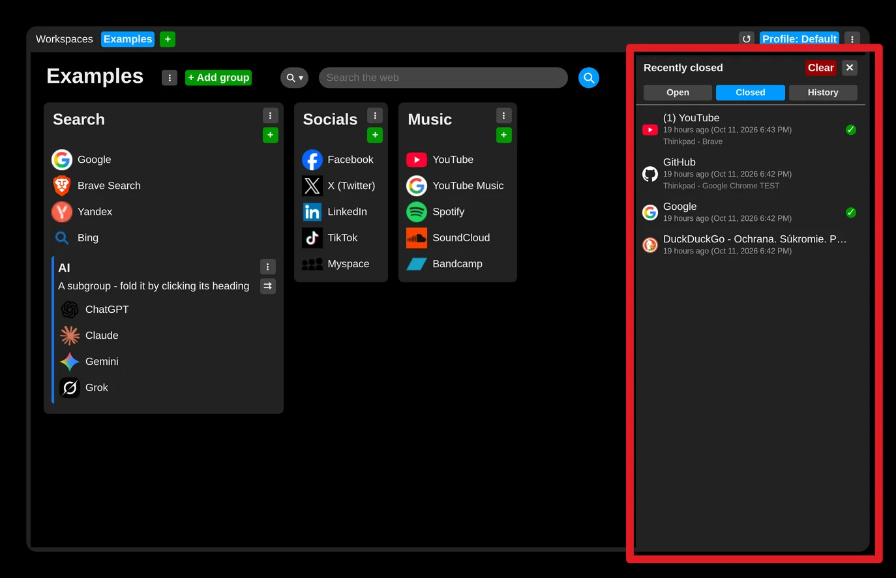

# 0.2.0

*Released: 2026-10-11*

## Most important changes

- The side panel now has three cards: open tabs, closed tabs and browsing history
- Browsing history, recorded only when you turn it on, and synchronized like closed tabs
- A new Privacy section in the settings: recording of closed tabs and history can be turned off
- Synchronization can be switched off per browser while staying signed in
- The exact time of a closed tab beside how long ago it was closed

### The side panel's three cards

- **Open** - the tabs open in this browser, to switch to, close or keep as links. This list is read
  from the browser when the panel is drawn and is never stored or sent anywhere.
- **Closed** - recently closed tabs, as before, now with the exact time beside "X ago".
- **History** - recently visited pages: 50 on a free account, 1000 on premium. Off until you turn
  it on; when on, it is synchronized like closed tabs.

### Privacy

**Settings → Privacy** holds both switches: recording closed tabs (on by default) and recording
browsing history (off by default). Turning either off deletes what it recorded, in this browser and
on the account.

- [Watch your privacy](../../tips/en/setup-privacy.md)

### Signed in without synchronizing

Every sign-in dialog and the account menu now have a **"Synchronise this browser with the account"** checkbox.
Unticked, the browser stays signed in - premium still applies - but nothing is sent or received:
links, closed tabs and history stay in this browser. Premium is also re-checked regularly.

### Fixes

- A failed sign-in no longer closes the sign-in dialog.
- The "Let's begin" tip was added to the tips bar.
