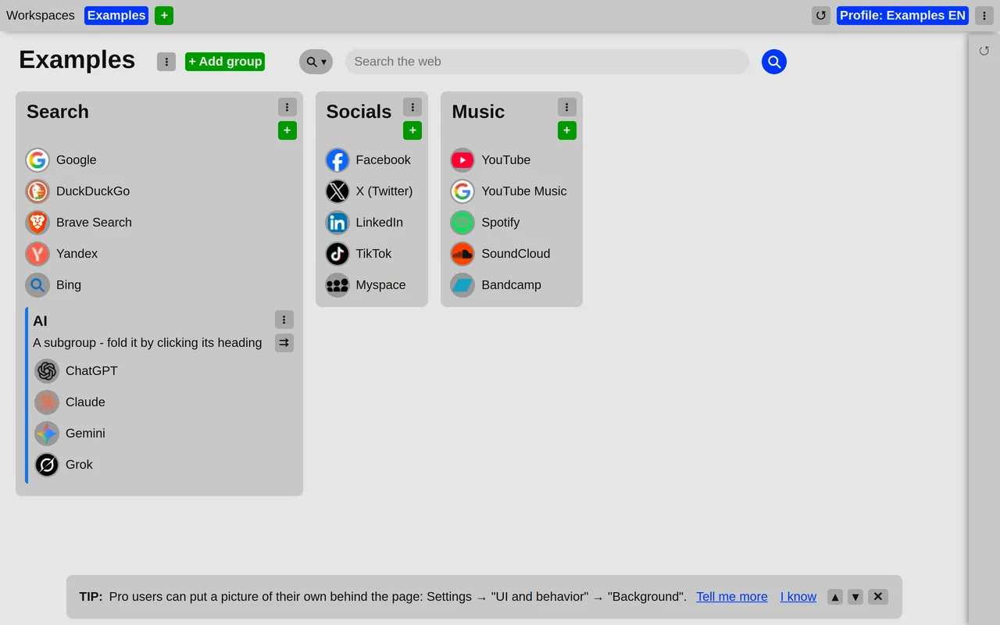
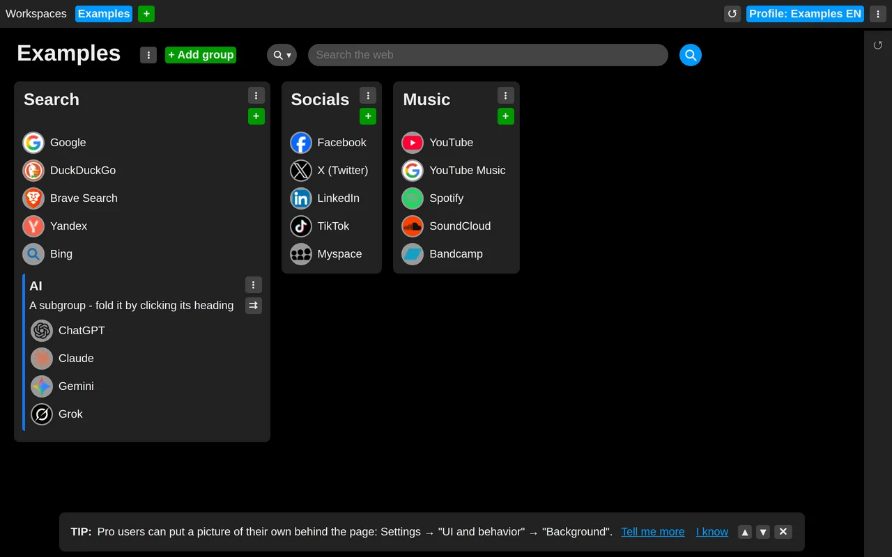

# 0.3.0

*Released: 2026-10-19*

## Most important changes

- A light theme: follow the system, always light or always dark
- A tip about choosing the theme
- Smoother scrolling of long lists in the side panel
- The footer stays at the bottom of the page

### Light and dark

The new tab page now comes in a light theme as well as the dark one. By default it follows the
system's setting; it can also be kept always light or always dark. The theme belongs to the
browser, not to the profile, so a laptop and a desktop can each have their own.

The light theme was tuned for displays with a limited color range: stronger hovers, website icons
on a disc so dark icons stay visible, and clearer buttons and menu items.

- [Choose a light or dark theme](../../tips/en/choose-theme.md)

### Also in this release

- Rows of the side panel that are out of view are no longer laid out, so long lists of closed tabs
  and history scroll more smoothly.
- A gap instead of a border under the header, and a darker search field when hovered.
- The footer stays at the bottom of the page.
