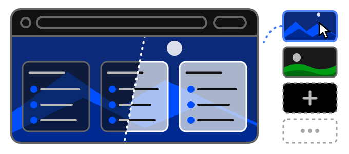

# 0.4.0

*Released: 2026-10-26*

## Most important changes

- A reworked interface: more compact, calmer, without the flicker and the stray artifacts
- Light and dark theme, each in a flat or a glass (Aero) style - glass is the new default
- Backgrounds: sixteen built-in pictures or one of your own, now in the free version too
- The search bar searches your saved links, open and closed tabs and history first, and offers the web search after them
- A side panel that is easier to work with: a search field, history by day, and it stays open when you want it to

### Made to feel like home

You are going to see this page often, so it should be yours. Choose a **light or dark theme** - or
let it follow your system - and a **style**: flat, or the new **glass (Aero)** look, where groups,
menus and panels let the background through, blurred.

Behind it, put one of **sixteen built-in backgrounds** or **a picture of your own**. Built-in
pictures are downloaded in full quality when you choose them; your own stay in your browser and are
never synchronized. Backgrounds are no longer a premium feature.

- [Choose a light or dark theme](../../tips/en/choose-theme.md)
- [Change background](../../tips/en/change-background.md)

### A reworked interface

The whole page was redrawn: more compact groups and menus, menus that always open above everything
else, no dimming behind dialogs, no flicker at the end of a hover, and website icons on a disc
coloured from the icon itself.

### Search your own things first

Start typing in the search bar and it suggests what you already have - **saved links** from every
workspace of the profile, **open tabs**, **closed tabs** and **history** - with the **web search**
offered last. Enter opens the first suggestion.

- [Search using searchbar](../../tips/en/use-searchbar.md)

### The side panel

- A **search field** for closed tabs and history.
- **History grouped by day**, each day folded under its heading.
- **Keep open**: a checkbox in the panel, or in the settings, keeps it open beside the columns.
- **Closing takes a click**: a setting that keeps the panel open, once the mouse has opened it, until
  you open something in it or click outside it. It replaces the button that used to be in the header.
- A row opens **in this tab**, like a link on the page; the **⇉** button at the end of the row opens
  it in a new one.
- The panel no longer shifts under the mouse as it opens.

- [Discover history](../../tips/en/discover-history.md)

### Sync & privacy

The **Privacy** section of the settings is now **Sync & privacy**: it also holds "Synchronise this
browser", and closed tabs and history can each be left out of synchronization on their own.

- [Watch your privacy](../../tips/en/setup-privacy.md)

### Also in this release

- Saving a page always has somewhere to go: the bookmarking popup offers "New group…" and
  "New subgroup…", and makes a group for you when the workspace has none.
- Signing in again with a device name another of your devices uses now asks what to do.
- Renaming a workspace finishes when you click outside it.
- Managing links from a subgroup's menu shows their buttons again.
