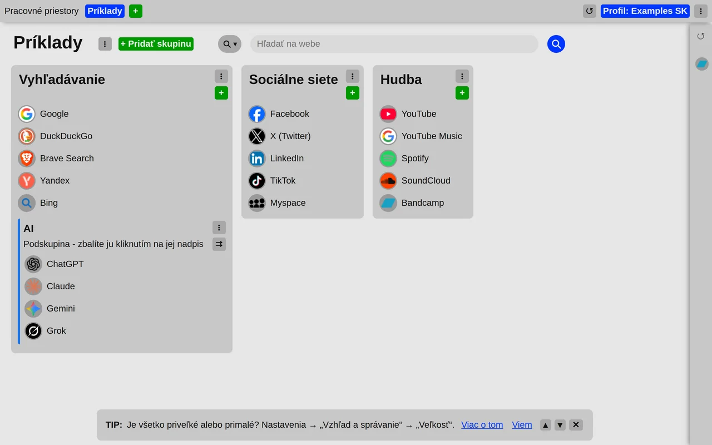
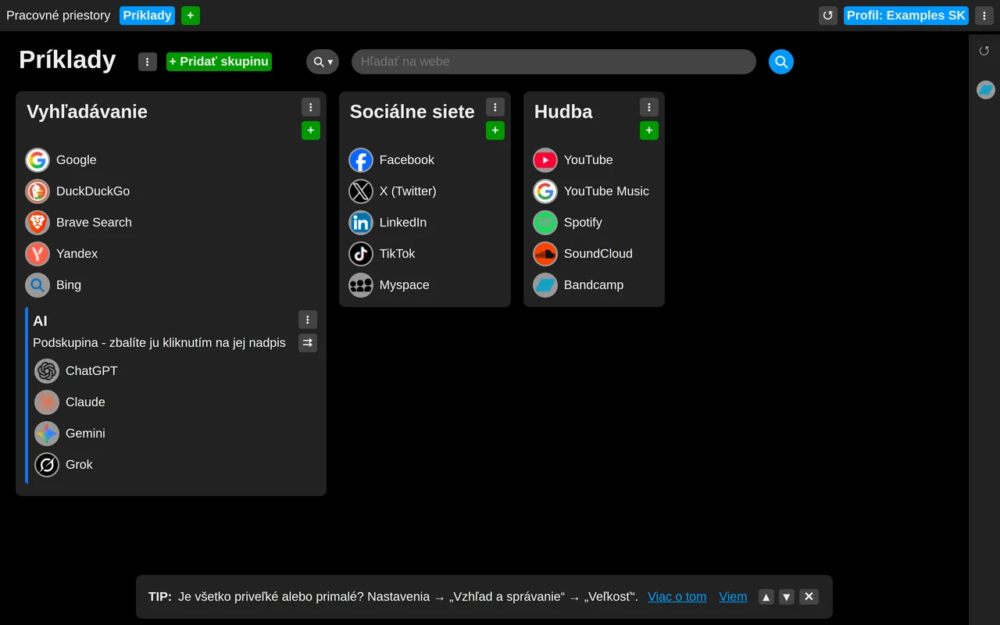

# 0.3.0

*Vydané: 2026-10-19*

## Najdôležitejšie zmeny

- Svetlý vzhľad: podľa systému, vždy svetlý alebo vždy tmavý
- Tip o výbere vzhľadu
- Plynulejšie posúvanie dlhých zoznamov v bočnom paneli
- Päta zostáva v spodnej časti stránky

### Svetlý a tmavý vzhľad

Nová karta má teraz okrem tmavého aj svetlý vzhľad. Predvolene sa riadi nastavením systému; dá sa
nechať aj vždy svetlý alebo vždy tmavý. Vzhľad patrí prehliadaču, nie profilu, takže notebook aj
stolný počítač môžu mať každý svoju.

Svetlý vzhľad bol vyladený pre displeje s obmedzeným farebným rozsahom: výraznejšie zvýraznenie pri
prechode myšou, ikony stránok na kruhovom podklade, aby tmavé ikony zostali viditeľné, a zreteľnejšie
tlačidlá a položky menu.

- [Svetlý alebo tmavý vzhľad](../../tips/sk/choose-theme.md)

### Ďalej v tomto vydaní

- Riadky bočného panela mimo zobrazenia sa už nevykresľujú, takže dlhé zoznamy zatvorených kariet a
  histórie sa posúvajú plynulejšie.
- Medzera namiesto čiary pod hlavičkou a tmavšie vyhľadávacie pole pri prechode myšou.
- Päta zostáva v spodnej časti stránky.
