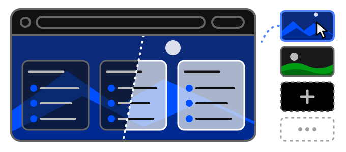

# 0.4.0

*Vydané: 2026-10-26*

## Najdôležitejšie zmeny

- Prepracované rozhranie: kompaktnejšie, pokojnejšie, bez blikania a zvyškov po animáciách
- Svetlý a tmavý vzhľad, každý v plochom alebo sklenenom (Aero) štýle - sklo je nové predvolené
- Pozadia: šestnásť vstavaných obrázkov alebo vlastný, odteraz aj v bezplatnej verzii
- Vyhľadávacie pole najprv prehľadá vaše uložené odkazy, otvorené a zatvorené karty a históriu, až potom ponúkne vyhľadávanie na webe
- Bočný panel, s ktorým sa ľahšie pracuje: vyhľadávanie, história po dňoch a zostane otvorený, keď chcete

### Aby ste sa tu cítili ako doma

Túto stránku budete vídať často, tak nech je vaša. Vyberte si **svetlý alebo tmavý vzhľad** - alebo
nech sa riadi systémom - a **štýl**: plochý, alebo nový **sklenený (Aero)**, v ktorom skupiny, ponuky
a panely prepúšťajú rozmazané pozadie.

Za ňu si dajte jedno zo **šestnástich vstavaných pozadí** alebo **vlastný obrázok**. Vstavané obrázky
sa stiahnu v plnej kvalite, keď si ich vyberiete; vaše vlastné zostávajú vo vašom prehliadači a nikdy
sa nesynchronizujú. Pozadie už nie je prémiová funkcia.

- [Svetlý alebo tmavý vzhľad](../../tips/sk/choose-theme.md)
- [Zmena pozadia](../../tips/sk/change-background.md)

### Prepracované rozhranie

Celá stránka je prekreslená: kompaktnejšie skupiny a ponuky, ponuky vždy nad všetkým ostatným, žiadne
stmavenie za dialógmi, žiadne bliknutie na konci prechodu myšou a ikony stránok na kruhovom podklade
zafarbenom podľa samotnej ikony.

### Najprv vaše vlastné veci

Začnite písať do vyhľadávacieho poľa a ponúkne to, čo už máte - **uložené odkazy** zo všetkých
pracovných priestorov profilu, **otvorené karty**, **zatvorené karty** a **históriu** - a
**vyhľadávanie na webe** nakoniec. Enter otvorí prvý návrh.

- [Vyhľadávanie cez vyhľadávací riadok](../../tips/sk/use-searchbar.md)

### Bočný panel

- **Vyhľadávanie** v zatvorených kartách a histórii.
- **História po dňoch**, každý deň zbalený pod svojím nadpisom.
- **Nechať otvorený**: zaškrtávacie políčko v paneli alebo v nastaveniach ho nechá otvorený vedľa
  stĺpcov.
- **Zatváranie kliknutím**: nastavenie, ktoré nechá panel otvorený, keď ho otvorí myš, kým v ňom
  niečo neotvoríte alebo nekliknete mimo neho. Nahrádza tlačidlo, ktoré bývalo v hlavičke.
- Riadok sa otvorí **v tejto karte**, ako odkaz na stránke; tlačidlo **⇉** na konci riadka ho otvorí
  na novej karte.
- Panel sa už pri otváraní neposúva pod myšou.

- [Objav históriu](../../tips/sk/discover-history.md)

### Synchronizácia a súkromie

Sekcia **Súkromie** v nastaveniach je teraz **Synchronizácia a súkromie**: obsahuje aj
„Synchronizovať tento prehliadač“ a zatvorené karty aj históriu možno každú zvlášť vynechať zo
synchronizácie.

- [Chráňte si svoje súkromie](../../tips/sk/setup-privacy.md)

### Ďalej v tomto vydaní

- Uloženie stránky má vždy kam ísť: okno záložiek ponúka „Nová skupina…“ a „Nová podskupina…“ a keď
  pracovný priestor nemá žiadnu skupinu, vytvorí ju za vás.
- Opätovné prihlásenie s názvom zariadenia, ktorý používa iné vaše zariadenie, sa teraz spýta, čo
  urobiť.
- Premenovanie pracovného priestoru sa dokončí kliknutím mimo neho.
- Správa odkazov z ponuky podskupiny opäť zobrazuje ich tlačidlá.
