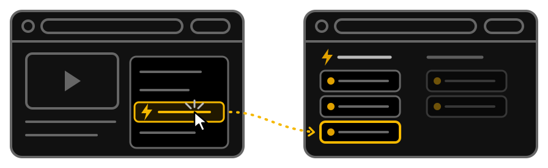

# Save in one click

- Made for **fast-paced link grabbers**: gathering material for a project, you keep finding pages worth keeping - and there is no time to decide where each one belongs.

- **Flash save** keeps the page at once, with no questions: right-click it → Tabilinks → Flash save, or press **Alt+Shift+F**. It lands in a "Flash save" group of the space you have open.

- Want it even faster? One setting leaves Flash save alone in the right-click menu - a single click per page.

- **Collect now, sort later**: once the material is together, drag the links into the groups where they belong.

- Ideal for example for **YouTube content creators** collecting sources, music and footage for the next video - or anyone researching before they write, build or buy.

  - [Flash save: keep a page in one click](../../tips/en/flash-save.md)
  - [Resize a group and sort its links](../../tips/en/resize-and-sort-groups.md)
