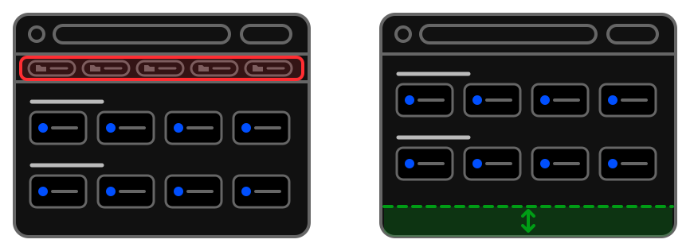

# Saves space

Did you keep bookmarks on the browser's bookmarks bar so they would always be close at hand? - 
You can now switch that bar off with a clear conscience and win back a few pixels of height.

Another great functionality that saves space - now on open tabs panel - is the browser's tab grouping:
You can set for each of the subgroups separately if it's pages (links) should be catched into groups 
when opened automatically or not.  
- [Links & tab groups](../../tips/en/subgroup-links-into-tab-group.md)
