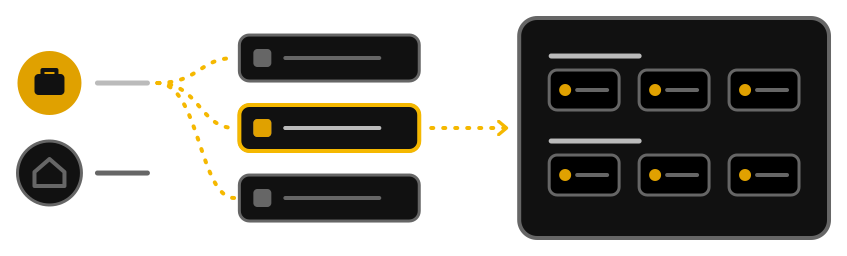

# Organize your agenda

- The promise is to bring hierarchy, order, discipline and clarity to your bookmarks.

- The hierarchy is designed to reflect how people organize things in real life.

  - [Spaces](../../tips/en/discover-workspaces.md)
  - [Profiles](../../tips/en/discover-profiles.md)
  - [What is a group]()

- **Tabilinks** can also serve as a **simple tab group organizer**:

  - [Open a subgroup's links in a tab group](../../tips/en/subgroup-links-into-tab-group.md)
