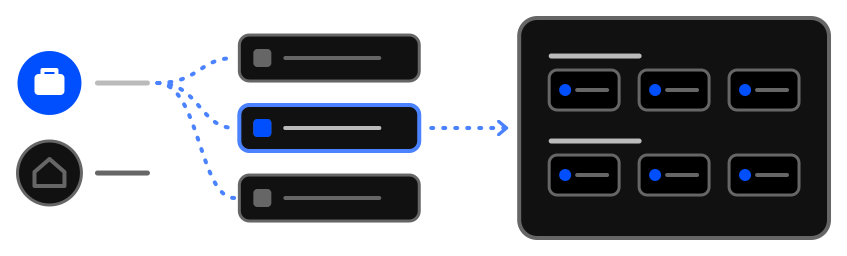

# Organize your agenda

- The promise is to give hierarchy, order, discipline and clarity to your bookmarks.

- Hierarchy and competence model is designed to reflect like humans performs in real life.

  - [Workspaces](../../tips/en/discover-workspaces.md)
  - [Profiles](../../tips/en/discover-profiles.md)
  - [What is a group]()

- **Tabilnks** can supply function of **simple tab grouping organizer**:

  - [Open a subgroup's links in a tab group](../../tips/en/subgroup-links-into-tab-group.md)
