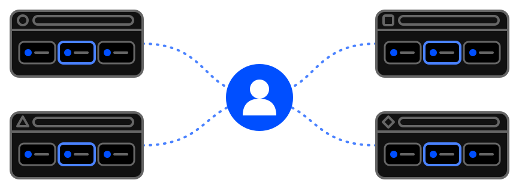

# Account only if you want one

- **You can start using extension the second the installation finished**.

  - [Add to Chrome](https://tabilinks.app/download)

- **Account** is only required if you want to **enable backup & synchronization** or for **validating PRO version**.

  - [Register / login, enable synchronization](https://tabilinks.app/download)
