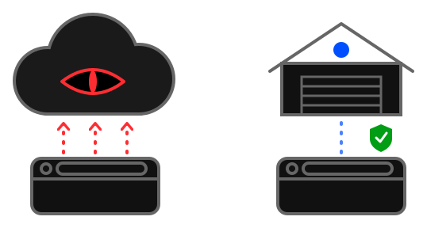

# Decide what you track and what is synced

- Extension works in **"offline first"** mode - it is **ready to use AS-IS**.

- You can be logged in, but any **sync may be disabled** per-device base.

- We know that history and recent tabs may be sensitive, so:

  - Tracking them can be disabled
  
  - Tracking them may be enabled, but syncing may be disabled

  - [Tracking / Sync settings](../../tips/en/setup-privacy.md)

- Even in full setup, Your data stays in Tabilinks database and goes nowhere. We are not big corporation making Orwell's 1984 reality. 
