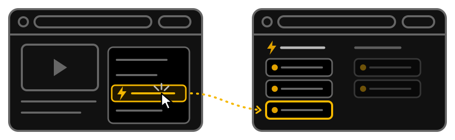

# Uloženie jedným kliknutím

- Pre tých, čo **zbierajú odkazy rýchlo**: pri zháňaní materiálu na projekt stále nachádzate stránky, ktoré stoja za to - a nie je čas rozhodovať, kam ktorá patrí.

- **Rýchle uloženie** stránku uloží hneď, bez otázok: pravé tlačidlo → Tabilinks → Rýchle uloženie, alebo **Alt+Shift+F**. Stránka sa ocitne v skupine „Rýchle uloženie“ v ploche, ktorú máte otvorenú.

- Ešte rýchlejšie? Jedno nastavenie nechá v ponuke pravého tlačidla len Rýchle uloženie - jedno kliknutie na stránku.

- **Zbierajte hneď, triedte neskôr**: keď je materiál pokope, pretiahnite odkazy do skupín, kam patria.

- Ideálne napríklad pre **tvorcov obsahu na YouTube**, ktorí zbierajú zdroje, hudbu a zábery na ďalšie video - alebo pre každého, kto si pred písaním, tvorbou či nákupom robí prieskum.

  - [Rýchle uloženie: stránka jedným kliknutím](../../tips/sk/flash-save.md)
  - [Zmeňte veľkosť skupiny a zoraďte jej odkazy](../../tips/sk/resize-and-sort-groups.md)
