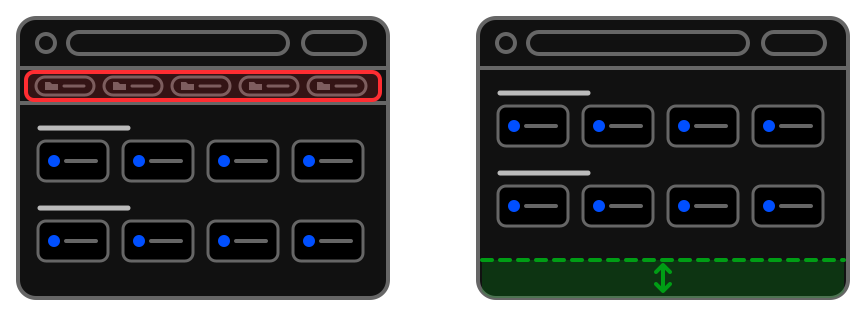

# Šetrí miesto

Mali ste záložky na vrchnom paneli prehliadača aby boli čo najviac poruke ? - 
Tento panel môžete teraz s kľudom deaktivovať a získať pár pixelov vertikálne naviac. 

Ďaľšia fajn funkcia ktorá šetrí miesto, tentokrát na paneli otvorených kariet - je skupinkovanie kariet: 
môžete osobitne pre jednotlivé podskupiny nastaviť či sa ich stránky majú alebo nemajú skupinkovať.
- [Linky a skupina kariet](../../tips/sk/subgroup-links-into-tab-group.md)
