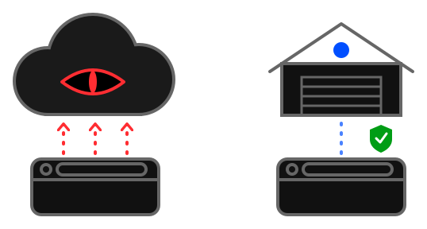

# Rozhodnite, čo sa sleduje a čo synchronizuje

- Rozšírenie funguje v režime **"offline first"** - je **pripravené na použitie hneď, tak ako je**.

- Môžete byť prihlásení a pritom mať **synchronizáciu vypnutú** pre jednotlivé zariadenia zvlášť.

- Vieme, že história a nedávne karty môžu byť citlivé, preto:

  - ich sledovanie je možné vypnúť

  - alebo sledovanie môže zostať zapnuté a synchronizácia vypnutá

  - [Nastavenia sledovania / synchronizácie](../../tips/sk/setup-privacy.md)

- Aj pri plnom nastavení zostávajú vaše dáta v databáze Tabilinks a nikam inam nejdú. Nie sme veľká korporácia, ktorá z Orwellovho románu 1984 robí skutočnosť.
