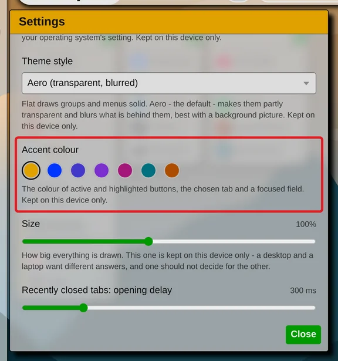
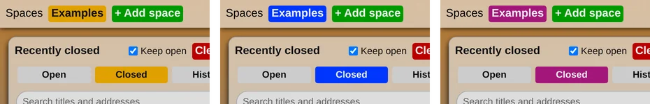
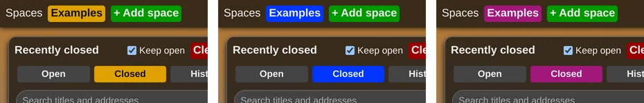

# Choose your accent colour

The accent colour is the one that says "this is active" - it colours active and highlighted buttons, the chosen tab and the field you are typing in. It is amber - Tabilinks' own colour - unless you pick another.

Choose it in Settings → "UI and behavior" → **"Accent colour"**, from seven swatches:

- **Amber** - the default, drawn with dark text on it, so it stays readable
- **Blue**
- **Indigo**
- **Violet**
- **Magenta**
- **Teal**
- **Orange**

The change applies straight away.

Like the theme, the accent colour is not synchronized; it is remembered only in the browser where you set it. To choose between light and dark, flat and glass: [Choose a light or dark theme](choose-theme.md)
