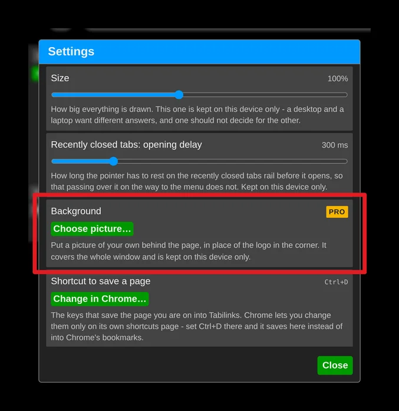
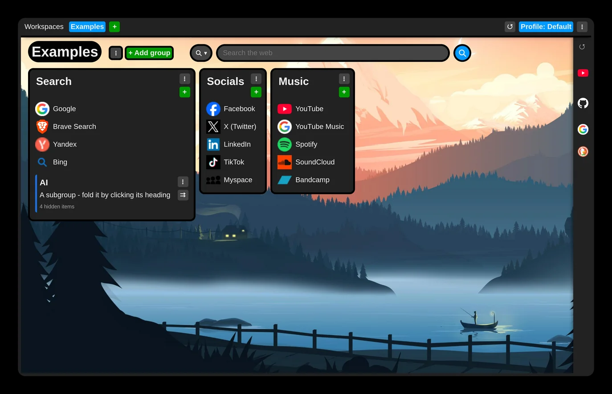

# Change background

You can put a picture of your own behind your new tab - in the free version as well as in premium.

To choose a wallpaper, open the extension settings and find the "Background" setting under "UI and behavior".

The picture is kept only on the device where you set it and is not synchronized to your other devices.

In the Aero theme style - the default - groups, panels and menus are partly transparent and blur the picture behind them. Prefer solid surfaces? Switch "Theme style" to Flat in the same section.

