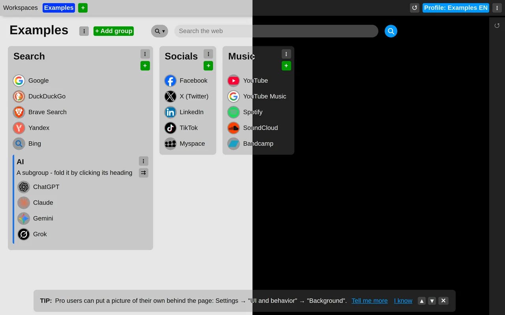

# Choose a light or dark theme

The extension can be drawn light or dark. Choose which in the extension settings: under the "UI and behavior" section, set "Theme" to one of:

- **Follow the system** – switches along with your operating system's light or dark mode. This is the default.
- **Always light**
- **Always dark**

The change applies straight away, in every new tab you have open.

This setting is not synchronized; it is remembered only in the browser where you set it.

