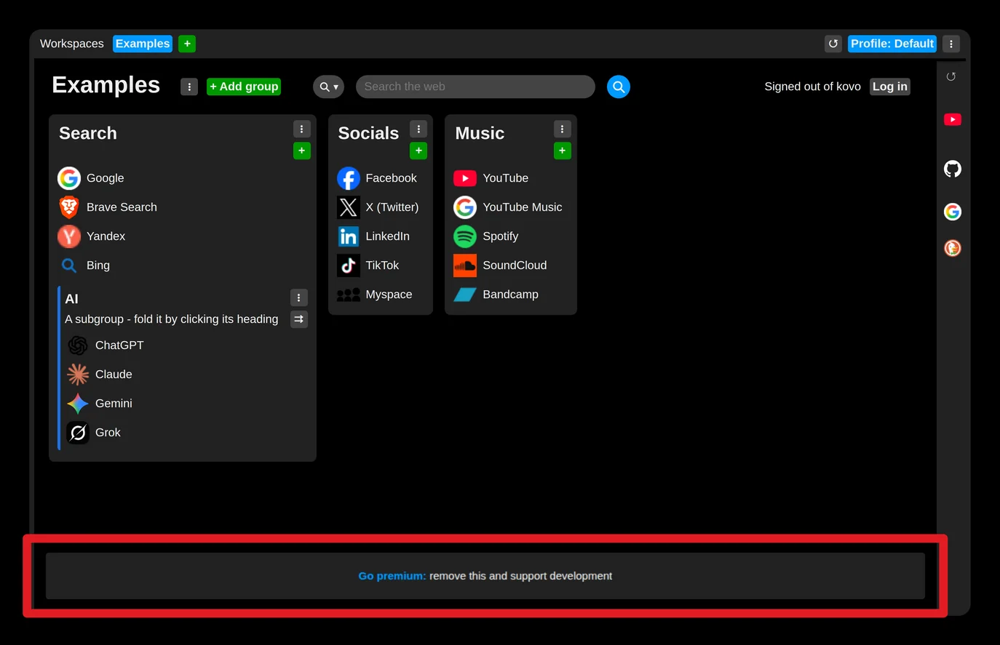
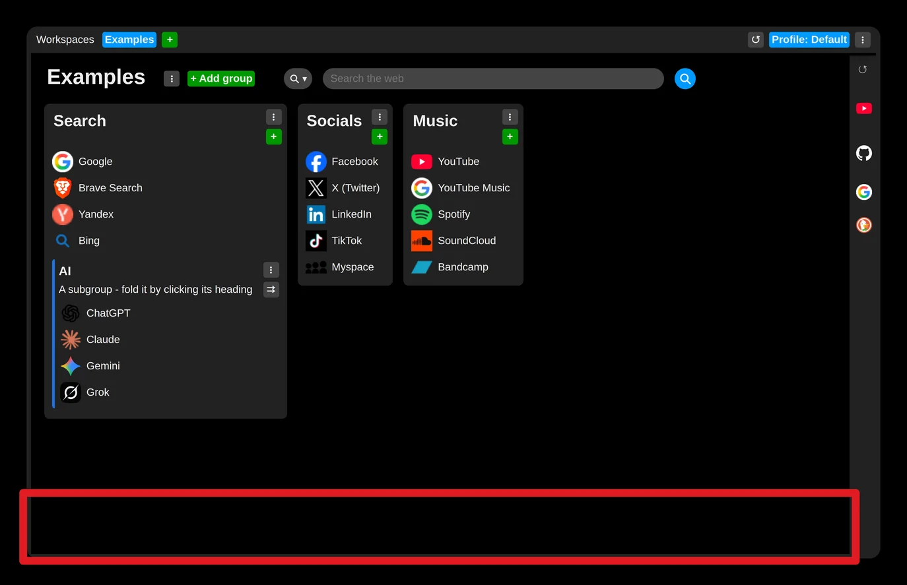

# Disable ads

If you activate the paid version of the app, one of the benefits is that the ads banner disappears from the extension.

The offer is right on the home page:

- [Home page](https://tabilinks.app)

The full version can be purchased here:

- [Account settings](https://tabilinks.app/account)

