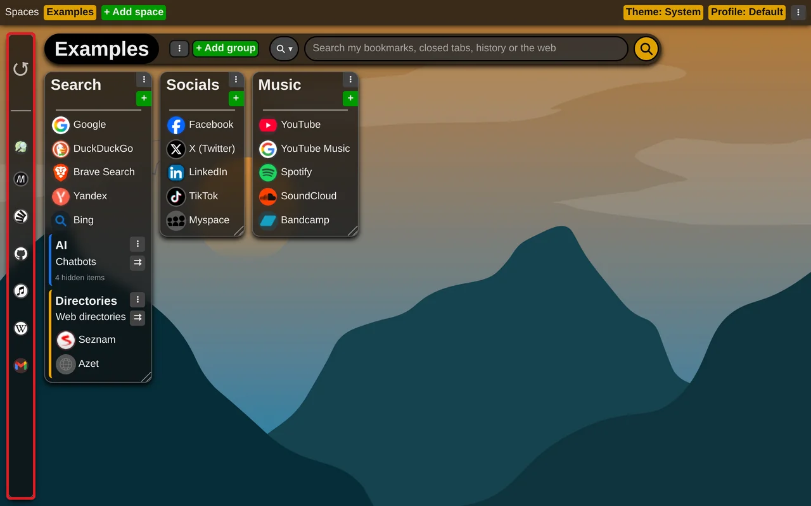
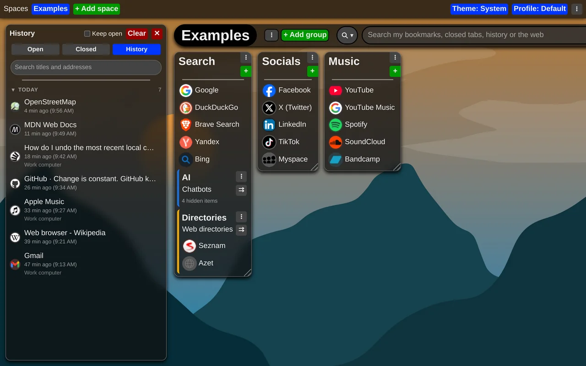
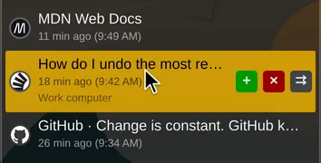

# Discover history

The side panel on the left of the page holds:
- the tabs open right now
- the history of recently closed tabs
- the history of visited pages
- your favorite links of the open space, once you turn Favorites on (Settings → "Functions")

Switch between them with the cards under the panel's head.

The panel is open beside your links from the start, because **"Keep open"** is checked - in the panel's head, or the same setting in Settings → "UI and behavior". Uncheck it and the panel folds into a narrow strip of icons along the left edge. Rest the mouse on the strip for a moment and the panel unfolds; move the mouse away and it folds again.

If you want it folded but not that quick to close, check **"Closing the side panel takes a click"** in Settings → "UI and behavior". Once the mouse has opened the panel, it stays open when the mouse moves away, until you open something in it or click outside it.

The search field under the cards finds closed tabs and visited pages by their title or address, and the history is grouped by day - click a day's heading to fold or unfold it.

Clicking a row opens the page in this tab, just as a link on the page does. The "⇉" button at the end of the row opens it in a new tab instead.

Of course this part is synchronized too (unless you have decided otherwise), so it shows the closed tabs and visited pages from all your installations.

The tabs open right now are not synchronized, and they are shown in the same order as on the browser's tab strip.

To add a page to your collection, use the "+" button or simply drag and drop it.

Pages already saved in some collection are marked with a green check mark.

With Favorites turned on, each row also has a circle. If the page is already a link in the open space, the circle marks it as a favorite; if it is not, it opens the save window with "Favorite" already ticked.
