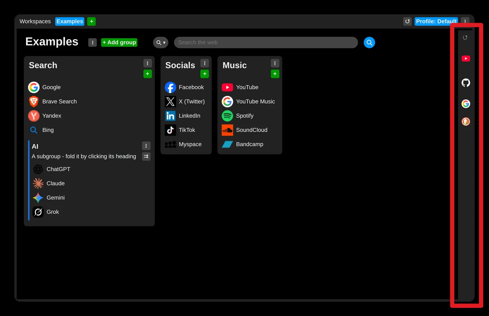
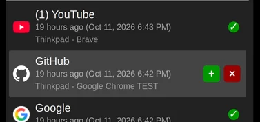

# Discover history

Moving the mouse to the very right edge of the page (over the panel) unrolls it and shows a panel that holds:
- the tabs open right now
- the history of recently closed tabs
- the history of visited pages

Moving the mouse away from the side panel, however, closes it again. If you would rather it stayed, there are two ways:

- **"Keep open"** - the checkbox in the panel's head, or the same setting in Settings → "UI and behavior", keeps the panel open beside your links all the time.
- **"Closing the side panel takes a click"** - in Settings → "UI and behavior". Once the mouse has opened the panel, it stays open until you open something in it or click outside it.

The search field under the cards finds closed tabs and visited pages by their title or address, and the history is grouped by day - click a day's heading to fold or unfold it.

Clicking a row opens the page in this tab, just as a link on the page does. The "⇉" button at the end of the row opens it in a new tab instead.

Of course this part is synchronized too (unless you have decided otherwise), so it shows the closed tabs and visited pages from all your installations.

The tabs open right now are not synchronized, and they are shown in the same order as on the browser's tab strip.

To add a page to your collection, use the "+" button or simply drag and drop it.

Pages already saved in some collection are marked with a green check mark.
