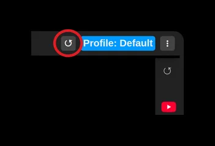
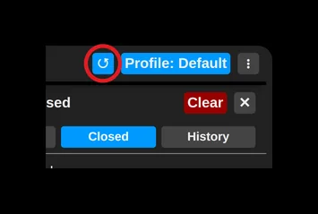

# Discover history

Moving the mouse to the very right edge of the page (over the panel) unrolls it and shows a panel that holds:
- the tabs open right now
- the history of recently closed tabs
- the history of visited pages

Moving the mouse away from the side panel, however, closes it again.

You can prevent that by opening the side panel with its button.

The panel then stays open until you click somewhere outside it.

Of course this part is synchronized too (unless you have decided otherwise), so it shows the closed tabs and visited pages from all your installations.

The tabs open right now are not synchronized, and they are shown in the same order as on the browser's tab strip.

To add a page to your collection, use the "+" button or simply drag and drop it.

Pages already saved in some collection are marked with a green check mark.
