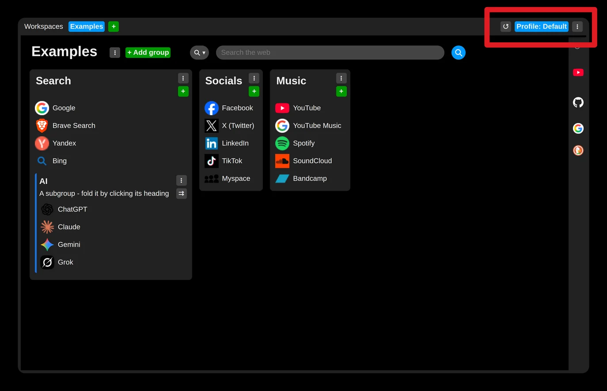
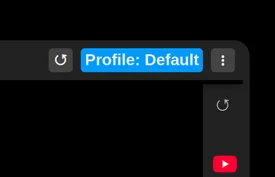
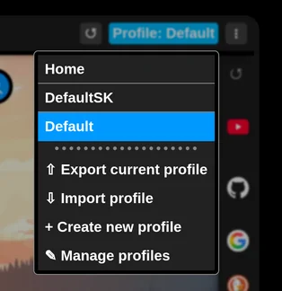
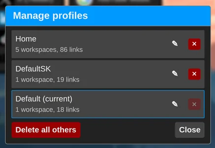

# Discover profiles

Profiles let you switch "your role" without having to switch to another account, which is the usual
solution in such cases.

Imagine you use your computer both at work and at home. Then two profiles may come in handy -
one for work and the other for your personal life.

An example of such a setup:

- Profile: Work
   
  Workspaces: "Development environment", "Testing", "Production", "Customer 1", "Customer 2", ...
- Profile: Home
   
  Workspaces: "Development", "Garage", "Band", "Fishing", ...

You can see the current profile at the top right of the new tab:

Click it to switch between profiles. The same menu also lets you create, export, import and
manage profiles:

**Export / import** - a profile can be exported to a file and loaded from a file. If you import the same profile in a newer version (edited elsewhere), it is overwritten.

**Create new profile** - creates a new profile, if your limit allows it.

**Manage profiles** - opens the profile manager, where profiles can be renamed or deleted.

Next tip / lesson, about workspaces: [Discover workspaces](discover-workspaces.md)
