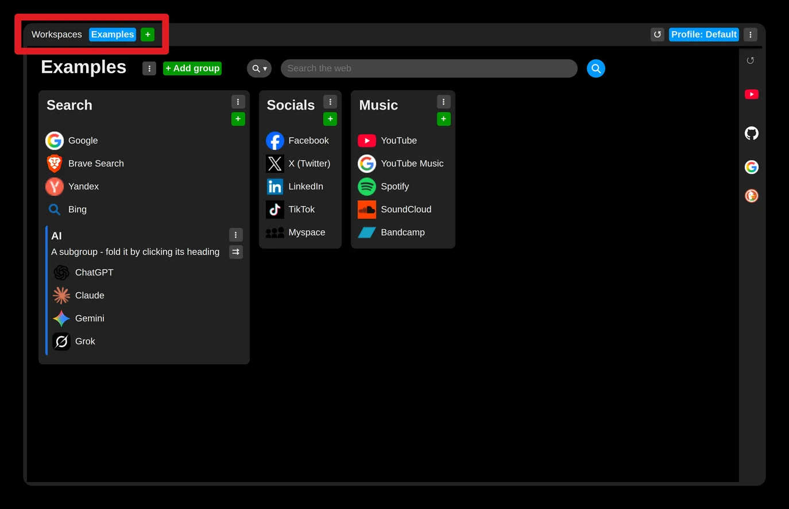
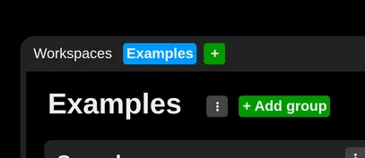

# Discover workspaces

Discover workspaces and start using them.

A workspace is something like a "main topic" or a supergroup for your current internet browsing,
or a continuous stretch of it.

Imagine you have several hobbies and interests, for example:

- Vintage cars and motorcycles
- Music / band
- Software development

Then you can create the workspaces "Garage", "Music" and "Development", and in them groups
and subgroups, for example:

Garage:

- Parts sellers
- Vintage clubs
- Forums
- Vehicle 1
  - Wiring diagrams
  - Carburettor setup and advice
  - Ignition timing tips

Music:

- Concerts
- Clubs
- Interesting bands

Development:

- Search and AI tools
- Servers and apps
- Hosting and domain registrars
- Utilities
- Git repositories

More about profiles too: [Discover profiles](discover-profiles.md)
