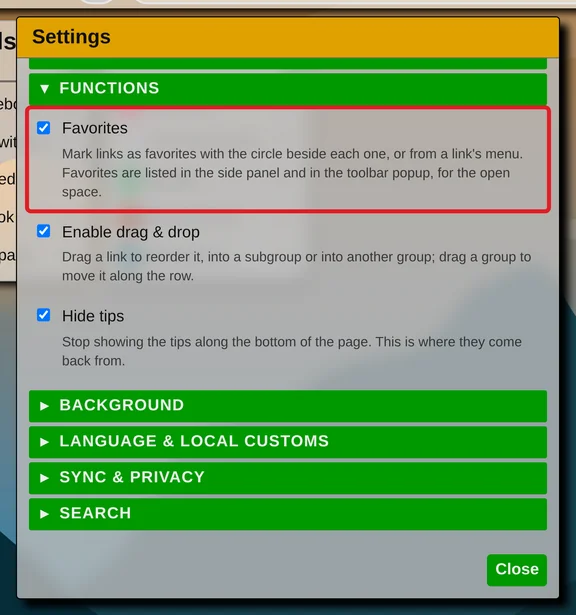
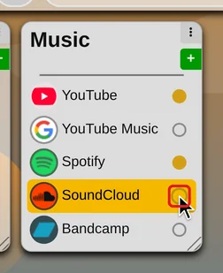
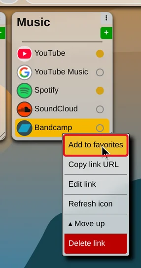
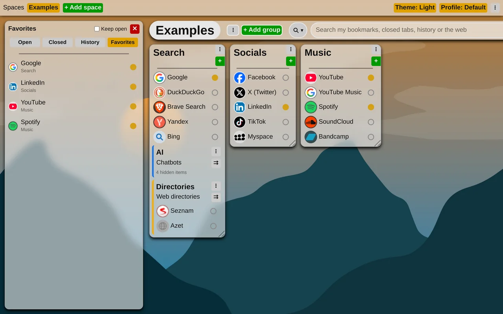
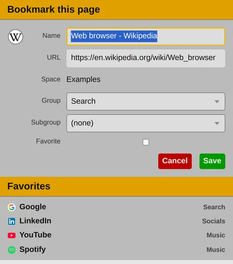

# Mark your favorites

Some links you open every day, others once a month. Mark the everyday ones as favorites and they are always one click away - in the side panel and in the toolbar popup.

Favorites are off until you turn them on: open the menu (the three dots at the top right) → Settings → "Functions" and check **"Favorites"**.

## Marking a link

From then on every link has a circle at its end. Click it and it turns golden - the link is a favorite. Click it again to unmark it.

A link can also be marked from its right-click menu, with **"Add to favorites"** and **"Remove from favorites"**, or straight away when you add it, by ticking **"Favorite"** in the save window.

## From the side panel and the search bar

Closed tabs, history, open tabs and the search suggestions have the circle too. If the open space already keeps a link with that address, the circle marks that link. If it does not, the save window opens with "Favorite" already ticked - a favorite has to be a link first.

## The Favorites card

The side panel has a **"Favorites"** card of its own. It lists the favorites of the space you have open, in the order the page shows them, each with the group it is in.

Drag a link onto the card to mark it. The link stays where it was, in its group.

The toolbar popup lists the same favorites under its form, so they are at hand on any page.

Favorites are synchronized with your account, just like the links themselves.

More about the side panel: [Discover history](discover-history.md)
