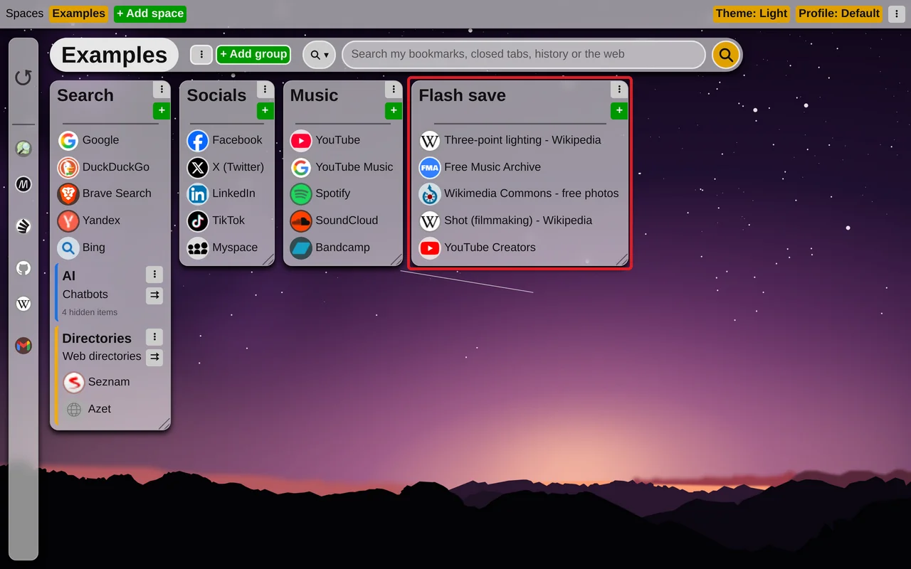
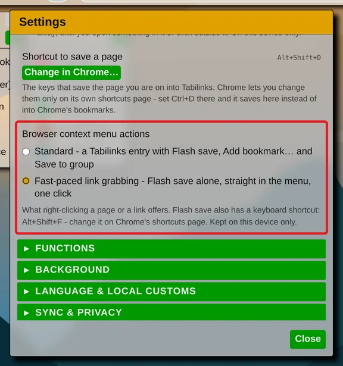

# Flash save: keep a page in one click

Found something worth keeping but no time to decide where it goes? Flash save keeps it now, and you sort it out later.

Right-click any page - or a link on it - open the **Tabilinks** entry and choose **Flash save**. The page is saved at once, with no questions, into a group called "Flash save" in the space you have open. The group is made the first time you use it, and the extension's icon in the toolbar shows a tick to say the page was kept.

## Without the mouse

**Alt+Shift+F** does the same for the page you are on, with no menu at all. You can change the shortcut on the browser's page chrome://extensions/shortcuts.

## One click instead of two

In Settings → "UI and behavior", "Browser context menu actions" decides what the right-click menu offers:

- **Standard** - the Tabilinks entry with Flash save, Add bookmark… and Save to group.
- **Fast-paced link grabbing** - only "Tabilinks: Flash save", straight in the menu, one click.

## When there is no room

A space holds 25 groups. If yours is full and has no "Flash save" group yet, nothing is saved and the popup tells you why. Delete a group, or rename one to "Flash save" so that it is used instead.

## Tidy up later

The "Flash save" group is an ordinary group. Put its links in order with "Sort links" in the group's menu, or drag them into the groups where they belong: [Resize a group and sort its links](resize-and-sort-groups.md), [Use drag-and-drop to organize items](use-drag-and-drop.md)

The rest of the right-click menu - saving with a name, or straight into a group you pick - is in [Save the page you are viewing](saving-from-webpage.md)

<!--
Still to be pictured by hand (the browser's own menus and toolbar, which a page screenshot cannot capture):
1. flash-save/1 - a web page with the browser's right-click menu open, the Tabilinks submenu showing "Flash save" highlighted.
2. flash-save/2 - the toolbar with the extension's icon showing the tick after a flash save.
5. flash-save/5 - the right-click menu in fast-paced mode, with the single "Tabilinks: Flash save" entry.
Suggested files: 1_1x.webp, 2_1x.webp and 5_1x.webp in images/LANG/tips/flash-save/
-->
