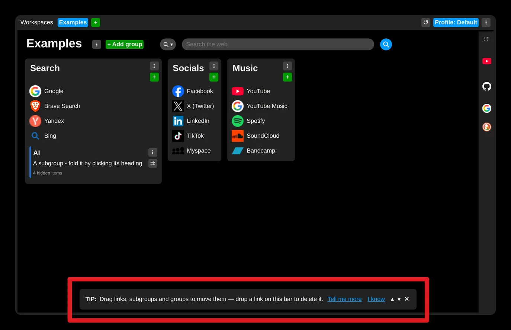
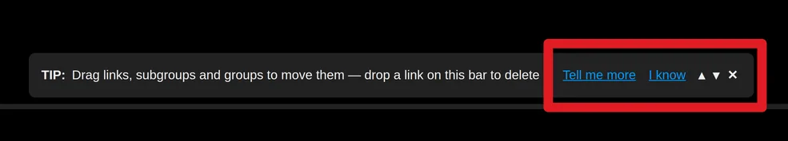
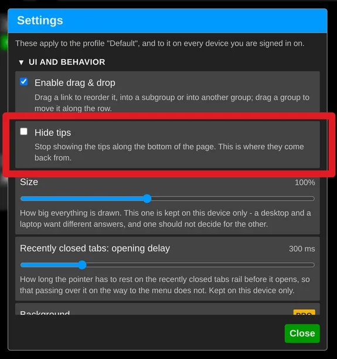

# Hide tips

If these tips get in your way, you can hide them.

- Use the **"X"** button on the tips bar, or open the extension settings and check "Hide tips" under "UI and behavior".
- Or, if you like the tips but already know one and do not want to see it again, click the **"I know"** button.

