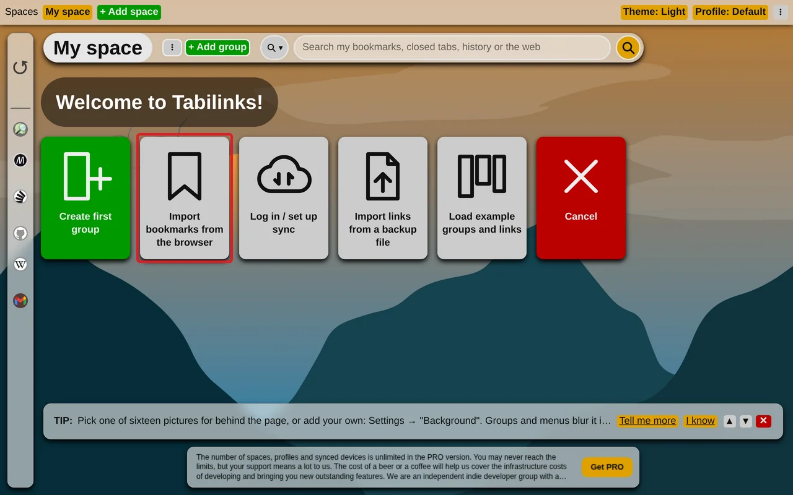
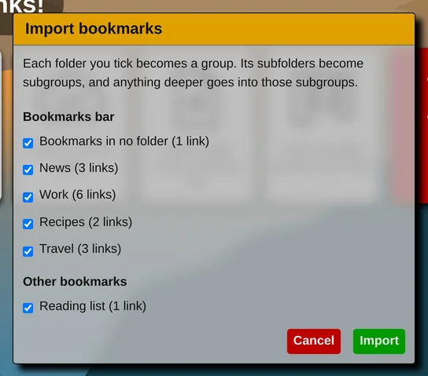
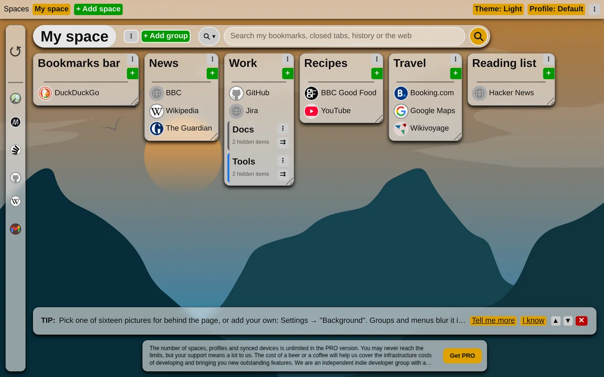
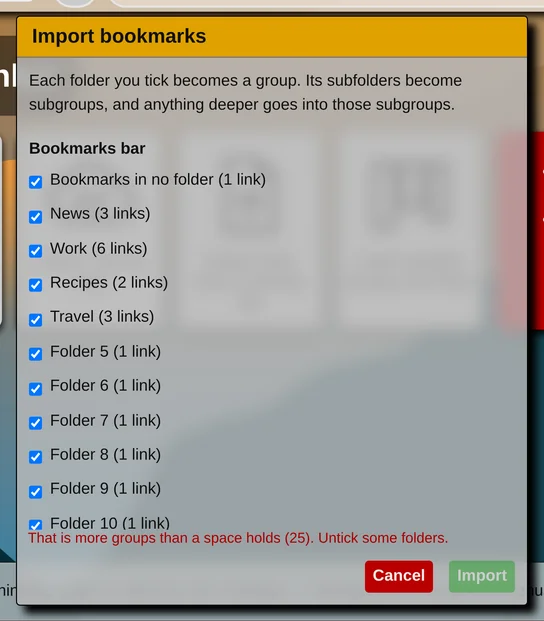

# Import your bookmarks from the browser

Years of bookmarks do not have to be typed in again. Tabilinks can turn your browser's bookmark folders into groups in one go.

On an empty space, the welcome tiles include **"Import bookmarks from the browser"**. Click it. The browser asks once for permission to read your bookmarks - only then, never before.

## Choosing what to bring

The dialog offers every folder that sits directly inside Bookmarks bar, Other bookmarks and Mobile bookmarks, each with the number of links in it, all ticked. Bookmarks lying loose in one of those, outside any folder, are offered too, as a group named after it.

Untick what you do not want, then click **"Import"**:

- each ticked folder becomes a group,
- its subfolders become subgroups,
- anything deeper goes into that subgroup.

Bookmarklets - bookmarks whose address starts with `javascript:` - are skipped.

## Limits

A space holds {fairUseGroupsPerWorkspace} groups, {fairUseSubgroupsPerGroup} subgroups in a group and {fairUseLinksPerWorkspace} links. If the ticked folders would go over any of these, the dialog says which, and "Import" stays disabled until you untick enough.

## Privacy

Your bookmarks are read in the browser and never sent anywhere. Once imported, they are ordinary links, and they synchronize with your account like any other.

Just installed Tabilinks? Start here: [Let's begin](lets-begin.md)

<!--
Still to be pictured by hand:
2. import-bookmarks/2 - the browser's permission prompt to read bookmarks (the browser's own, a page screenshot cannot capture it).
Suggested file: 2_1x.webp in images/LANG/tips/import-bookmarks/
-->
