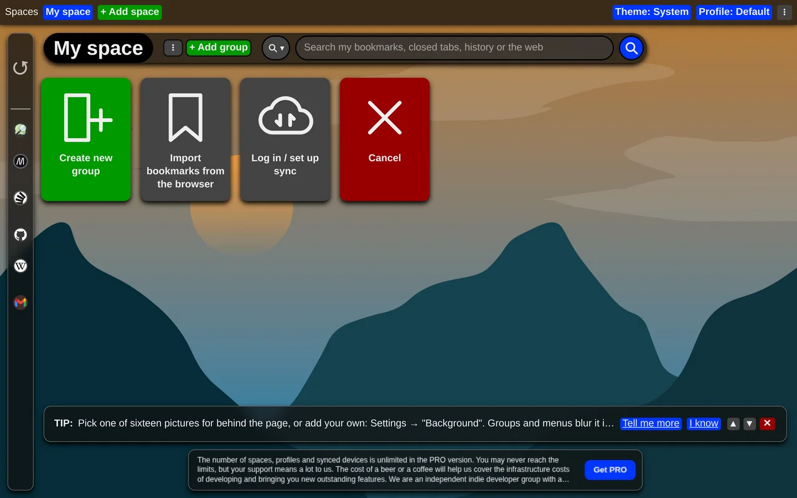
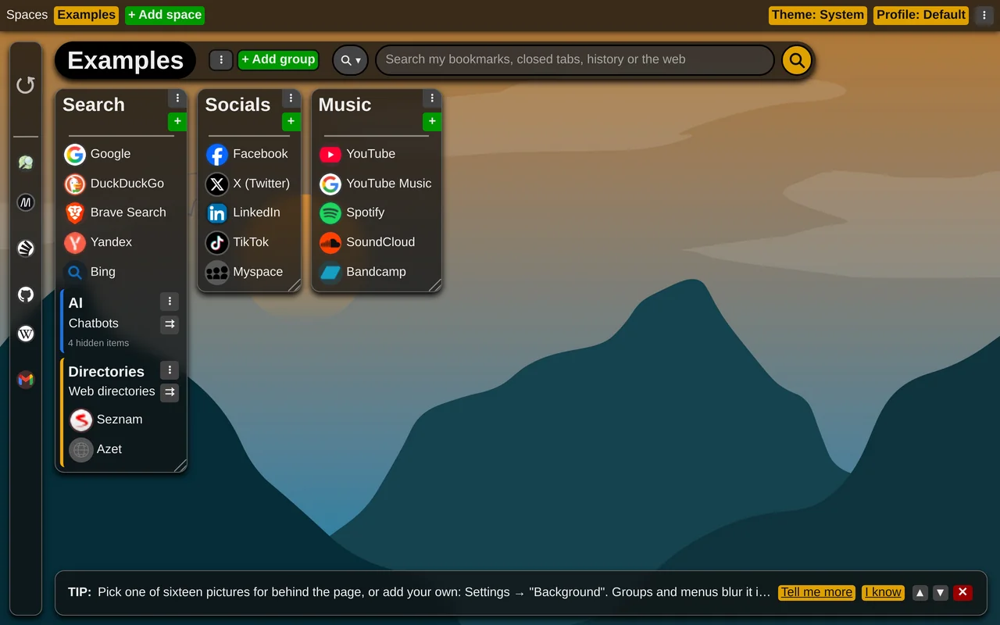
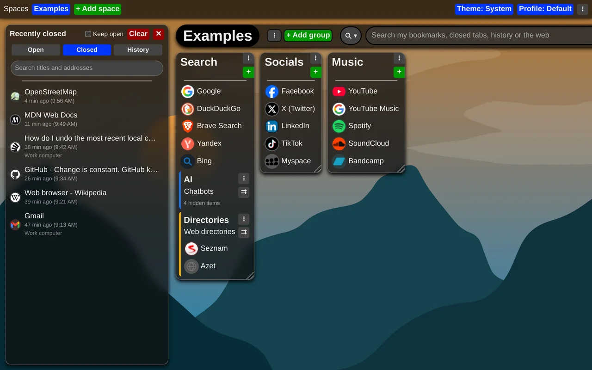
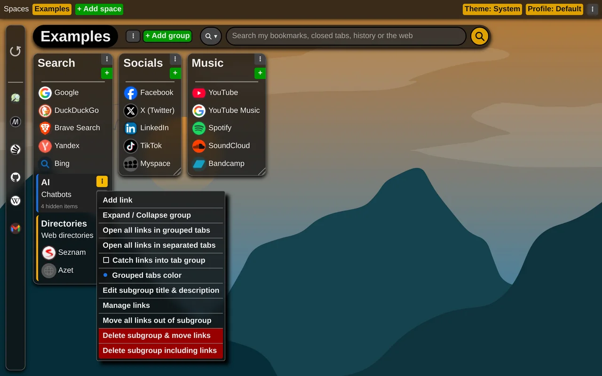
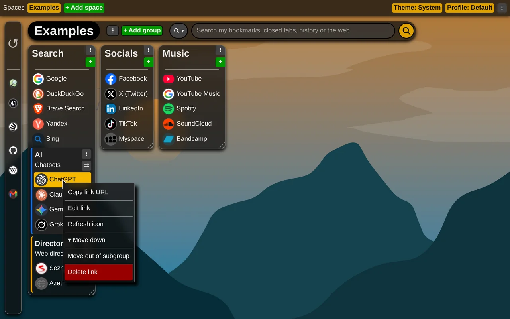

# Let's begin

Right after installation, a new tab opens straight into your first space, "My space". It is still empty, so it offers a few ways to fill it:

- **Create new group** - start with a group of your own and add links to it.
- **Import bookmarks from the browser** - each folder you tick becomes a group, and its subfolders become subgroups. The browser asks you to allow access to your bookmarks only at this moment.
- **Log in / set up sync** - if you already use Tabilinks elsewhere, bring your links from your account. Choose "I have a username and password" or "I have a sync code".

From then on, your links are what you will see every time you open a new tab.

The panel on the left holds your open tabs, closed tabs and history, and it is open beside your links from the start.

If you would rather have the room, uncheck "Keep open" in the panel's head: it folds into a strip of icons along the left edge. Rest the mouse on the strip for a moment (0.3 seconds by default; you can change this in the settings) and the panel unfolds again.

Now explore the menus wherever you see the "three vertical dots" symbol.

Links have a context menu of their own too, opened with a right click.

## Now you can go on to discover more features and tips:

### Working with items
- [Use drag and drop to arrange and move items](use-drag-and-drop.md)
- [Save the page you are viewing](saving-from-webpage.md)
- [Flash save: keep a page in one click](flash-save.md)
- [Mark your favorites](favorites.md)
- [Import your bookmarks from the browser](import-bookmarks.md)
- [Discover history](discover-history.md)

### Profiles
- [Discover profiles and what they are for](discover-profiles.md)

### Spaces
- [Discover spaces and what they are for](discover-workspaces.md)

### Link groups and subgroups
- [Roll up a subgroup](roll-the-subgroup.md)
- [Open all links from a subgroup at once](open-all-subgroups-link.md)
- [Catch links from a subgroup into a tab group](subgroup-links-into-tab-group.md)
- [Resize a group and sort its links](resize-and-sort-groups.md)

### Settings
- [Is everything too big or too small?](set-size.md)
- [Choose your accent colour](accent-colour.md)
