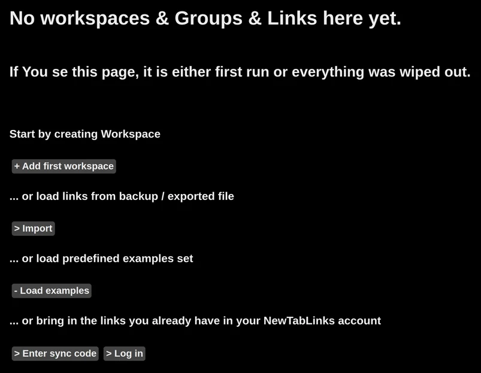
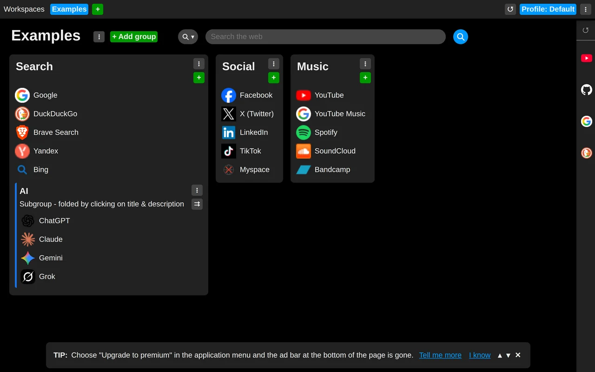
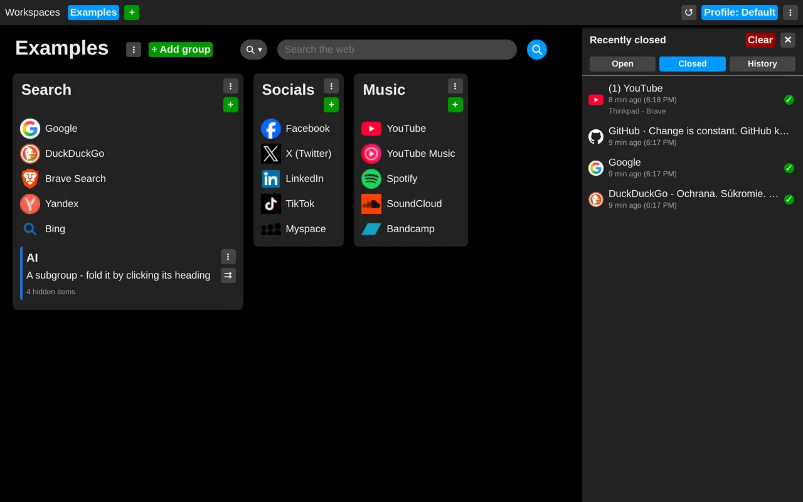
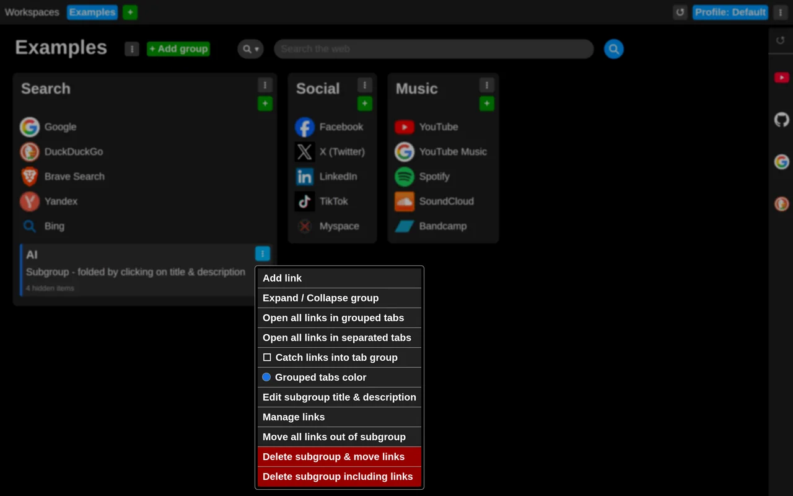
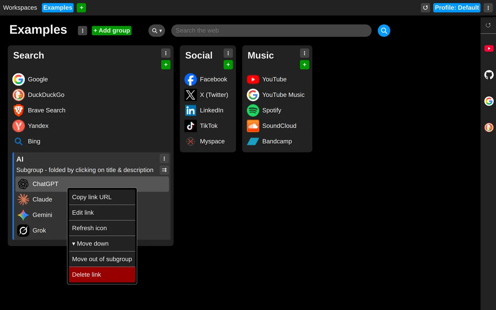

# Let's begin

This is what you may see the first time you open a new tab after a successful installation:

Let's assume this is the first time you are running the extension, so we can load some examples.

From now on, links like these are what you will see every time you open a new tab.

The panel of icons on the right edge holds your open tabs, closed tabs and history. 

Move the mouse to that edge and keep it
there for a moment (0.3 seconds by default; you can change this later in the settings) and the panel
will unfold.

Now explore the menus wherever you see the "three vertical dots" symbol.

Links have a context menu of their own too, opened with a right click.

## Now you can go on to discover more features and tips:

### Working with items
- [Use drag and drop to arrange and move items](use-drag-and-drop.md)

### Profiles
- [Discover profiles and what they are for](discover-profiles.md)

### Workspaces
- [Discover workspaces and what they are for](discover-workspaces.md)

### Link groups and subgroups
- [Roll up a subgroup](roll-the-subgroup.md)
- [Open all links from a subgroup at once](open-all-subgroups-link.md)
- [Catch links from a subgroup into a tab group](subgroup-links-into-tab-group.md)

### Settings
- [Is everything too big or too small?](set-size.md)
