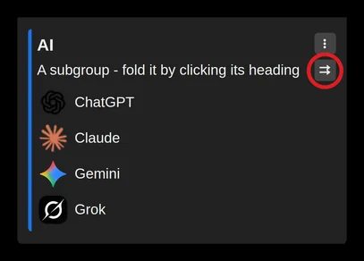

# Open all links in a subgroup at once

All the links in a subgroup can be opened at once, using the double arrow button next to the subgroup title and description. They open in a new tab group.

The subgroup's menu (three dot icon) also offers "Open all links in separated tabs".

Or pages can be caught into a tab group automatically: [Catch links from a subgroup into a tab group](subgroup-links-into-tab-group.md)
