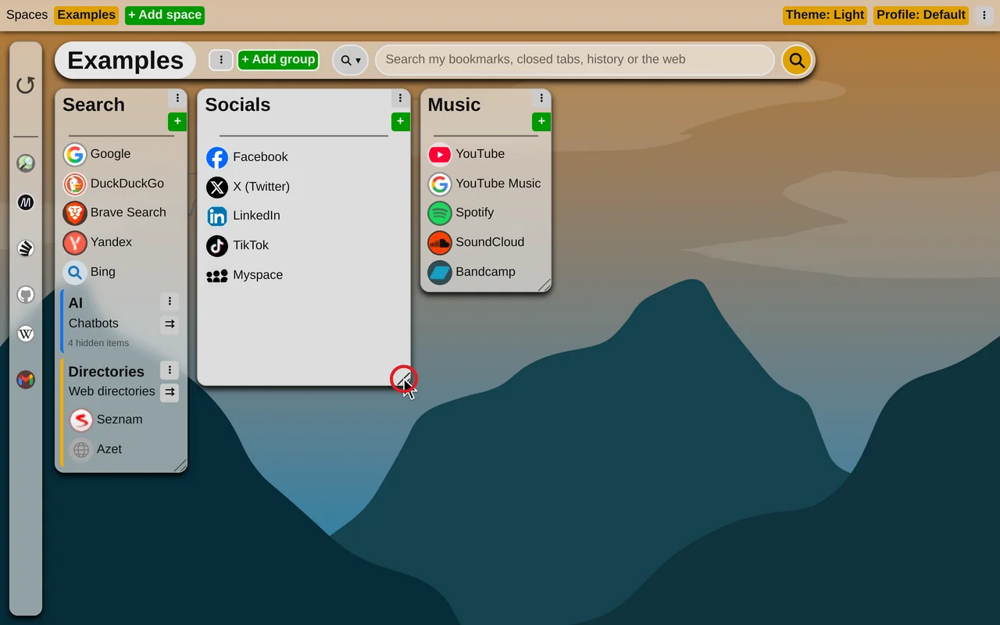
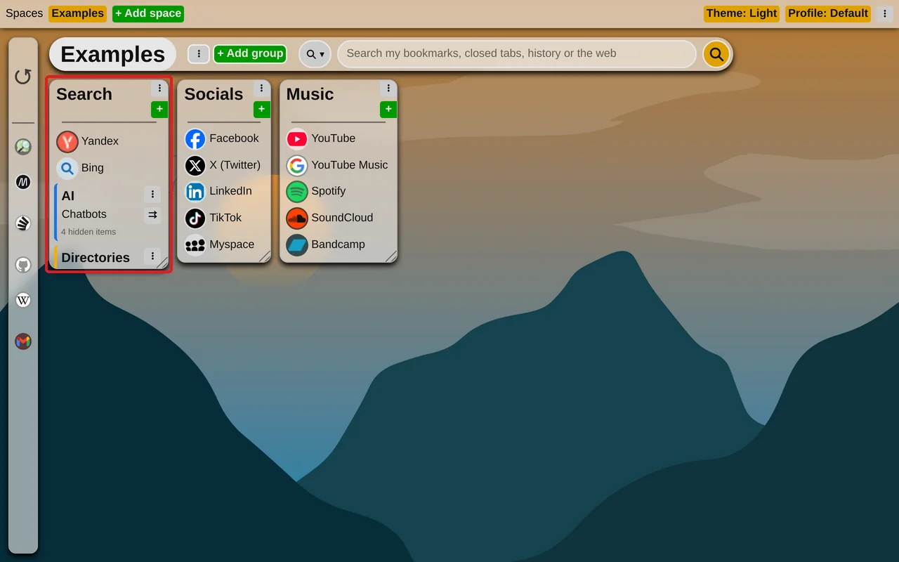
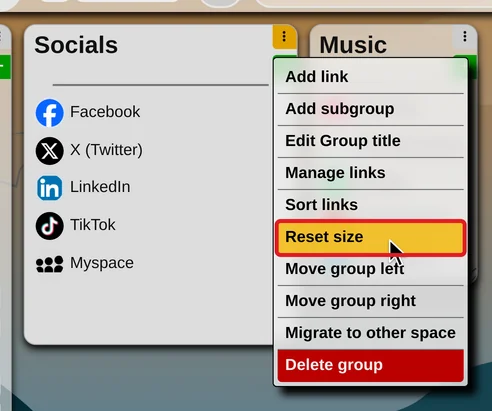
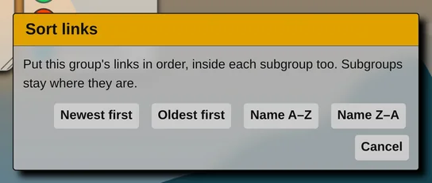

# Resize a group and sort its links

A group does not have to be as wide and as tall as the page makes it. Make it the size you want, and put its links in order with one click.

## Resize

Drag a group's bottom-right corner to set its width and height - wider, narrower, taller or shorter, in any direction. A group made shorter than its links scrolls.

The size is remembered on this device only, so a wide screen and a small laptop can each have their own. To go back to the automatic size, double-click the corner, or choose **"Reset size"** in the group's menu (the three dots).

## Sort

Choose **"Sort links"** in the group's menu, then one of:

- **Newest first**
- **Oldest first**
- **Name A–Z**
- **Name Z–A**

Subgroups keep their places, and their own links are sorted too.

Sorting is done once, it is not a setting: links you add later go to the end, and you can still move any of them by dragging. [Use drag-and-drop to organize items](use-drag-and-drop.md)

<!--
Still to be pictured:
5. resize-and-sort-groups/5 - the same group before and after sorting by name, a subgroup in the same place in both.
Suggested file: 5_1x.webp in images/LANG/tips/resize-and-sort-groups/
-->
