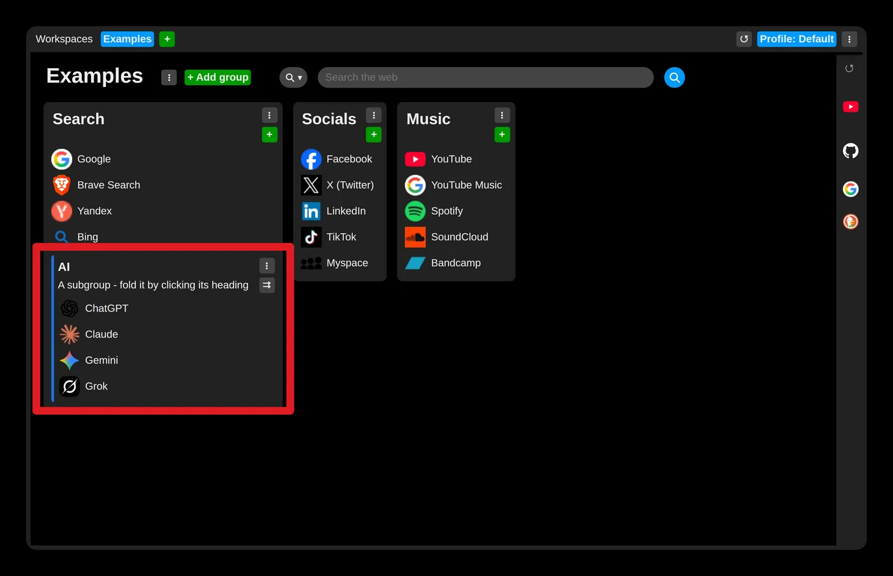
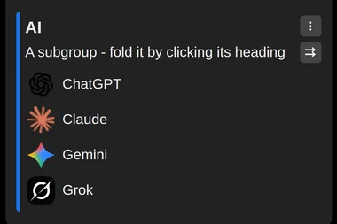
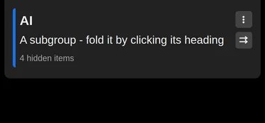

# Roll up a subgroup

The links in a subgroup can be hidden by rolling the subgroup up: click its header, or choose "Expand / Collapse group" in its menu (three dot icon).

Then only the number of hidden items is shown, which saves vertical space.

The setting is remembered, so a rolled or unrolled subgroup stays that way, on all your synchronized devices.
