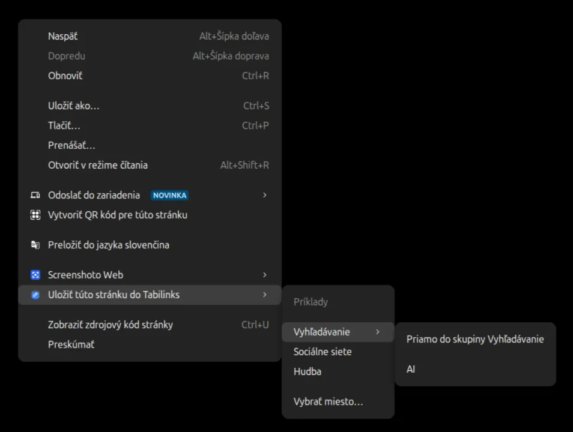
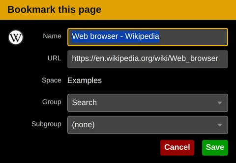

# Save the page you are viewing

Right-click the page you are on - or a link on it - and open the **Tabilinks** entry. It offers three ways to keep it:

- **Flash save** - keeps it at once, with no questions, in a group called "Flash save" in the space you have open. The group is made the first time you use it. The keyboard shortcut is **Alt+Shift+F**. More in [Flash save: keep a page in one click](flash-save.md)
- **Add bookmark…** - opens the save window, where you choose the name, the space, the group and the subgroup.
- **Save to group** - choose a group or a subgroup of the open space right in the menu, and the page is saved there, with nothing to fill in.

Grabbing links fast? In Settings → "UI and behavior", set "Browser context menu actions" to **Fast-paced link grabbing**: Flash save is then alone and straight in the right-click menu, one click away.

If the open space has no room for another group, Flash save does not save anything and tells you why.

The save window also opens from the extension's button in the browser's top bar, and with its keyboard shortcut (Alt+Shift+D, unless you changed it). You can even make Ctrl+D open it: [Save pages with Ctrl+D](ctrl-d-saves-here.md)

