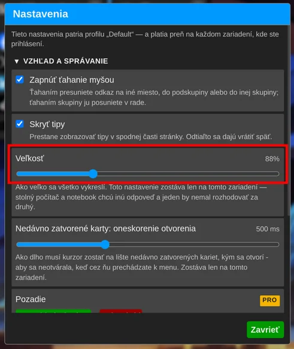
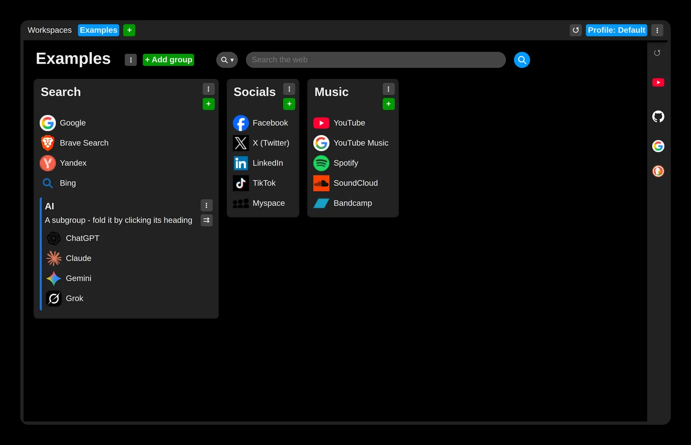
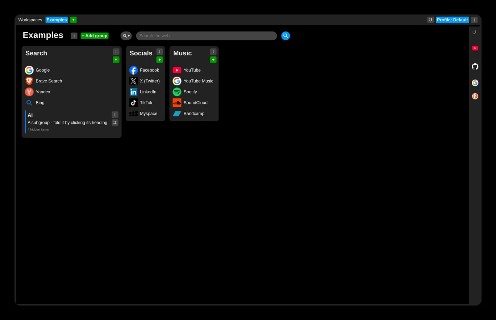

# Set the size of everything

Set the size of UI elements in the extension settings: under the "UI and behavior" section, drag the "Size" slider until everything looks right.

This setting is not synchronized and is stored separately for each browser.

Example at 100% size:

Example at 75% size:

