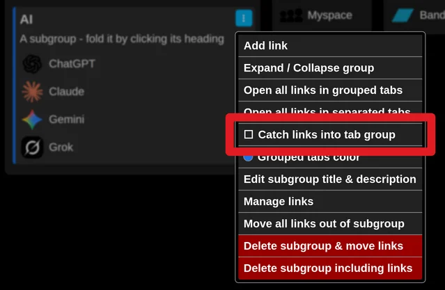
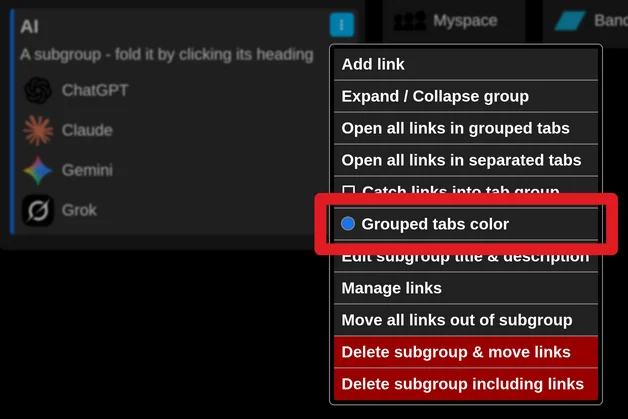

# Catch links from a subgroup into a tab group

Each subgroup can be set up so that its links are placed into a tab group automatically when you open them.

Turn this on in the subgroup's menu (three dot icon) by checking "Catch links into tab group".

If you do not like the current color of that tab group, change it with "Grouped tabs color".

The color of the subgroup's left edge matches the color of the tab group.

