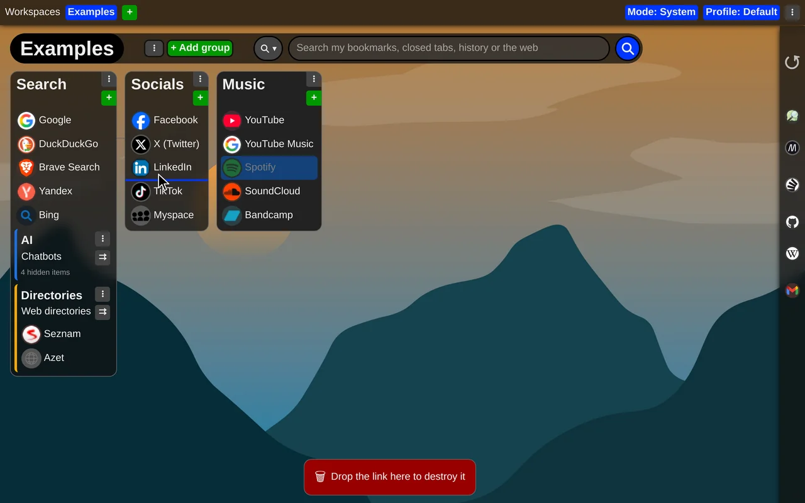
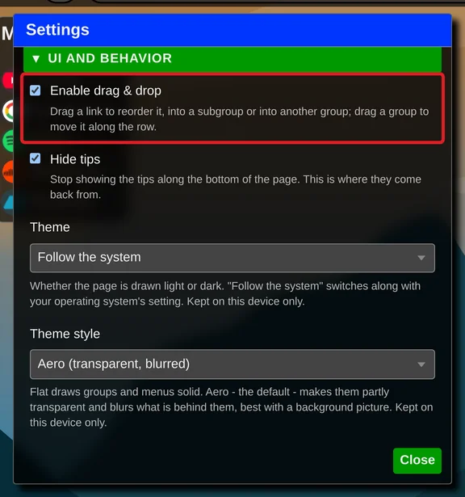

# Use drag-and-drop to organize items

Groups, subgroups and links can be arranged with the mouse: pick one up and drop it where you want it.

You can:

- change the order of links in groups and subgroups
- move links between groups and subgroups
- move whole groups and subgroups
- drag a link from "Recently closed tabs" and save it to a group or subgroup
- delete a link by dropping it on the bar at the bottom of the page, which turns into a trash while you drag

Drag and drop is on from the start. If you would rather not move things by accident, turn it off in the extension settings under "UI and behavior" by unchecking "Enable drag & drop".

