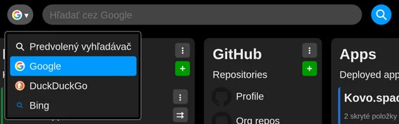

# Search using searchbar

Start typing and the search bar first suggests what you already have, before anything goes to the web:

- your **saved links**, from every workspace of the profile,
- the **tabs open** in this browser,
- your **closed tabs** and **history**,
- and last, **search the web** for what you typed.

Your own links come first, and a title starting with what you typed beats one that only contains it. Use the arrow keys to move through the list; Enter opens the highlighted entry - the first one unless you move. A saved link, a closed tab or a page from the history opens in this tab; an open tab is switched to.

For the web search, the search bar uses your browser's own search engine by default.

If you want to use another supported search engine (Google, DuckDuckGo or Bing), just choose one from the dropdown next to the search bar.

This setting is not synchronized; it is remembered only in the browser where you set it.
