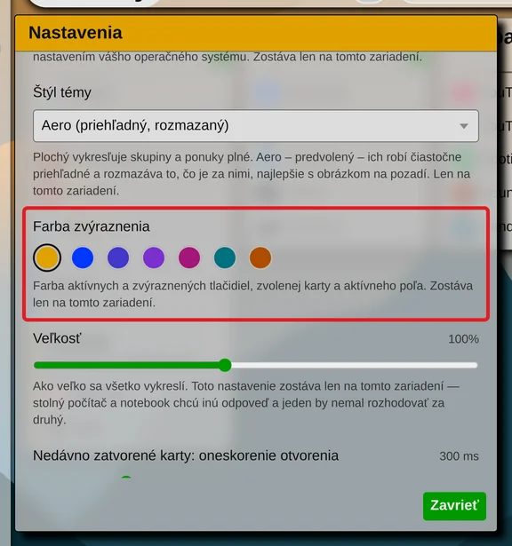
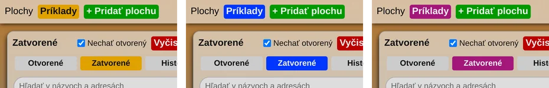
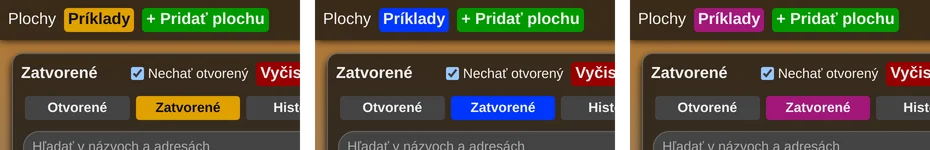

# Vyberte si farbu zvýraznenia

Farba zvýraznenia je tá, ktorá hovorí „toto je aktívne“ - zafarbí aktívne a zvýraznené tlačidlá, zvolenú kartu a pole, do ktorého práve píšete. Predvolene je jantárová, vlastná farba Tabilinks, a môžete si vybrať inú.

Vyberiete ju v Nastaveniach → „Vzhľad a správanie“ → **„Farba zvýraznenia“**, zo siedmich vzoriek:

- **Jantárová** - predvolená, s tmavým textom, aby zostala čitateľná
- **Modrá**
- **Indigová**
- **Fialová**
- **Purpurová**
- **Tyrkysová**
- **Oranžová**

Zmena sa prejaví hneď.

Rovnako ako vzhľad sa farba zvýraznenia nesynchronizuje a je uložená vždy pre konkrétny prehliadač. Ako si vybrať svetlý alebo tmavý, plochý alebo sklenený vzhľad: [Svetlý alebo tmavý vzhľad](choose-theme.md)
