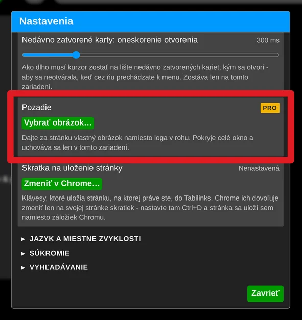
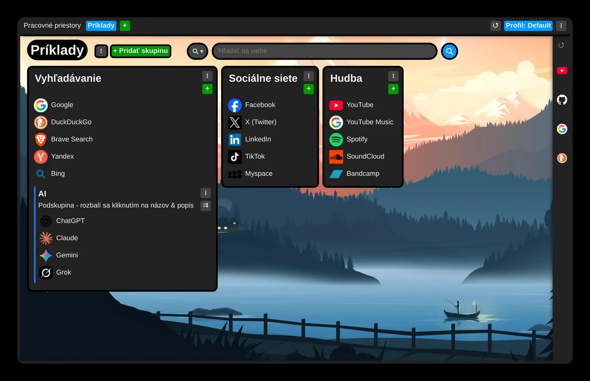

# Zmena pozadia

Za novú kartu si môžete dať vlastný obrázok - v bezplatnej verzii rovnako ako v prémiovej.

Tapetu si vyberiete v nastaveniach rozšírenia, v sekcii „Vzhľad a správanie“ nájdete nastavenie „Pozadie“.

Obrázok sa uloží len v zariadení, kde ste ho nastavili, a do ostatných zariadení sa nesynchronizuje.

V štýle témy Aero - predvolenom - sú skupiny, panely a ponuky čiastočne priehľadné a obrázok za nimi rozmazávajú. Uprednostňujete plné plochy? V tej istej sekcii prepnite „Štýl témy“ na Plochý.

