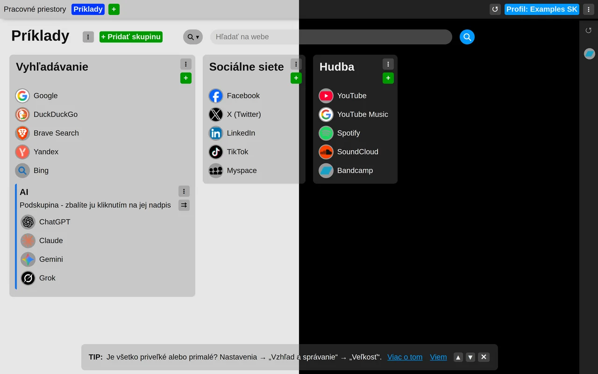

# Svetlý alebo tmavý vzhľad

Rozšírenie sa môže vykresliť svetlé alebo tmavé. Vyberiete si v nastaveniach rozšírenia: v sekcii „Vzhľad a správanie“ nastavte „Vzhľad“ na jednu z možností:

- **Podľa systému** – prepína sa spolu so svetlým alebo tmavým režimom vášho operačného systému. Toto je predvolená možnosť.
- **Vždy svetlý**
- **Vždy tmavý**

Zmena sa prejaví hneď, vo všetkých otvorených nových kartách.

## Plochý alebo sklenený

Hneď pod ním „Štýl témy“ určuje, ako sa vykreslia skupiny, panely a ponuky:

- **Aero** – čiastočne priehľadné, rozmazávajú obrázok na pozadí za sebou, ako matné sklo. Toto je predvolená možnosť.
- **Plochý** – plné plochy.

Oba štýly fungujú so svetlým aj tmavým vzhľadom, takže máte na výber štyri kombinácie.

Tieto nastavenia sa nesynchronizujú a sú uložené vždy pre konkrétny prehliadač.

