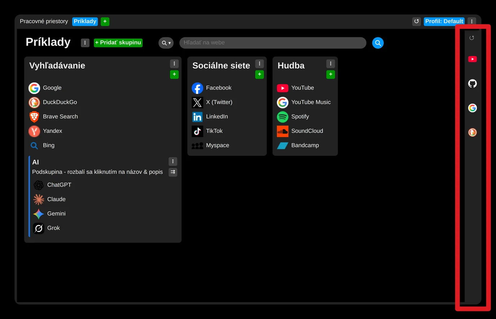
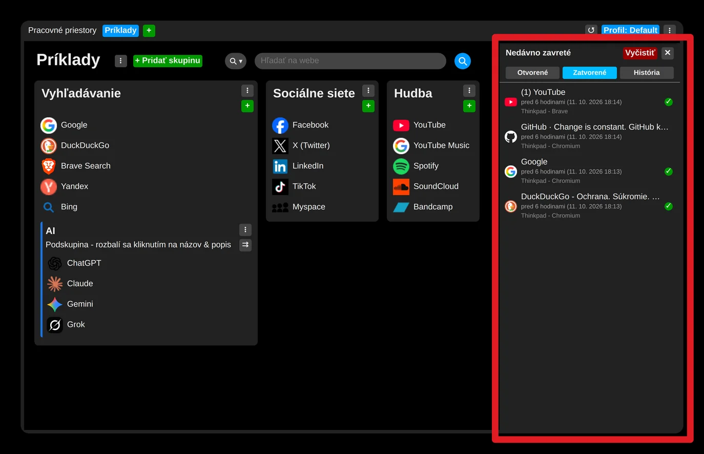
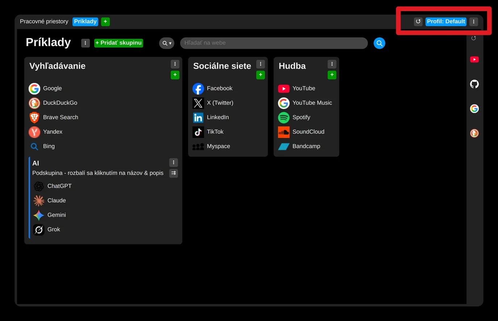
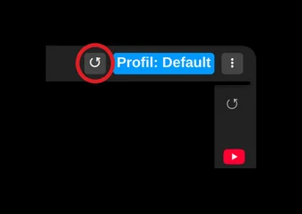
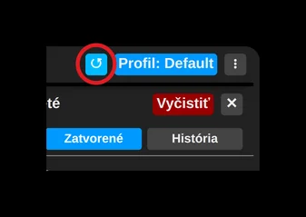
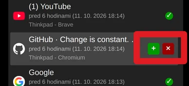

# Objav históriu

Pohyb myši na úplne pravý okraj stránky (nad panel) spôsobí odrolovanie tohoto panela a zobrazí sa panel, ktorý obsahuje:
- momentálne otvorené karty
- história naposledy zavretých kariet
- história navštívených stránok

Pohyb myši mimo ponuky bočného panela ale spôsobí jej opätovné zavretie. 

Predísť tomuto správaniu je možné otvorením bočného panelu pomocou jeho tlačidla. 

Panel zostane otvorený až po dobu kým nie je zaznamenaný klik mimo jeho oblasť. 

Samozrejme aj táto časť je synchronizovaná (ak používateľ neurčil inak) a vidno tam zavreté karty a navštívené stránky zo všetkých inštalácií.

Momentálne otvorené karty sa nesynchronizujú a sú zobrazené v poradí ktoré odpovedá ich poradiu na paneli kariet prehliadača.

Pre pridanie niektorej stránky do kolekcie stačí potom použiť tlačidlo "+" alebo jednoducho využiť "ťahaj a pusť".

Stránky, ktoré už boli uložené do nejakej kolekcie budú označené zelenou fajkou.
