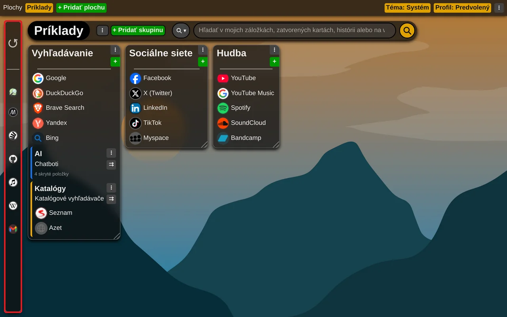
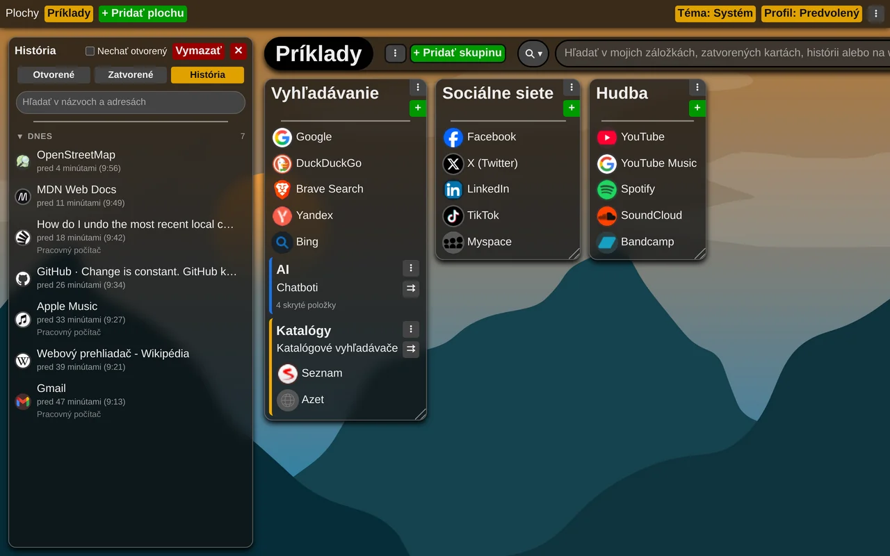
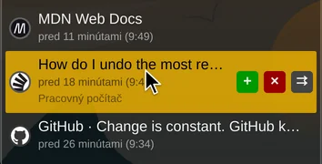

# Objav históriu

Bočný panel na ľavej strane stránky obsahuje:
- momentálne otvorené karty
- históriu naposledy zavretých kariet
- históriu navštívených stránok
- vaše obľúbené odkazy otvorenej plochy, keď si zapnete Obľúbené (Nastavenia → „Funkcie“)

Prepínate medzi nimi kartami pod hlavičkou panela.

Panel je od začiatku otvorený vedľa vašich odkazov, pretože je zaškrtnuté **„Nechať otvorený“** - v hlavičke panela alebo rovnaké nastavenie v Nastaveniach → „Vzhľad a správanie“. Keď ho odškrtnete, panel sa zbalí do úzkeho pásu ikon pozdĺž ľavého okraja. Keď na ňom chvíľu podržíte myš, panel sa rozbalí; keď myš odtiahnete, opäť sa zbalí.

Ak ho chcete mať zbalený, ale nie tak rýchlo zatvárateľný, zaškrtnite **„Bočný panel sa zatvára kliknutím“** v Nastaveniach → „Vzhľad a správanie“. Keď panel otvorí myš, zostane otvorený, aj keď myš odtiahnete, kým v ňom niečo neotvoríte alebo nekliknete mimo neho.

Vyhľadávacie pole pod kartami nájde zatvorené karty a navštívené stránky podľa názvu alebo adresy a história je zoskupená po dňoch - kliknutím na nadpis dňa ho zbalíte alebo rozbalíte.

Kliknutie na riadok otvorí stránku v tejto karte, rovnako ako odkaz na stránke. Tlačidlo „⇉“ na konci riadka ju namiesto toho otvorí na novej karte.

Samozrejme aj táto časť je synchronizovaná (ak používateľ neurčil inak) a vidno tam zavreté karty a navštívené stránky zo všetkých inštalácií.

Momentálne otvorené karty sa nesynchronizujú a sú zobrazené v poradí ktoré odpovedá ich poradiu na paneli kariet prehliadača.

Pre pridanie niektorej stránky do kolekcie stačí potom použiť tlačidlo "+" alebo jednoducho využiť "ťahaj a pusť".

Stránky, ktoré už boli uložené do nejakej kolekcie budú označené zelenou fajkou.

Keď máte zapnuté Obľúbené, každý riadok má aj krúžok. Ak je stránka v otvorenej ploche už uložená ako odkaz, krúžok ju označí ako obľúbenú; ak nie je, otvorí ukladacie okno s už zaškrtnutým „Obľúbený“.
