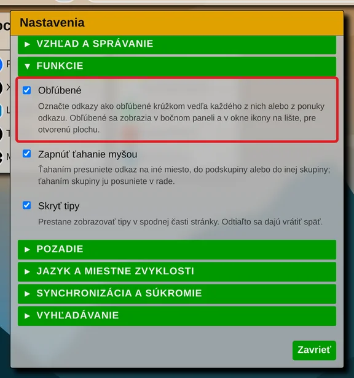
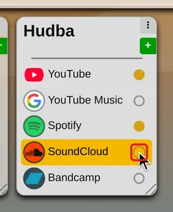
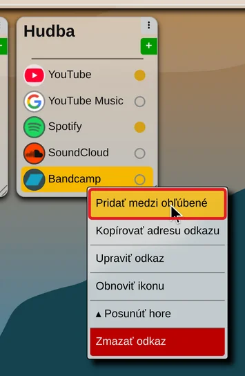
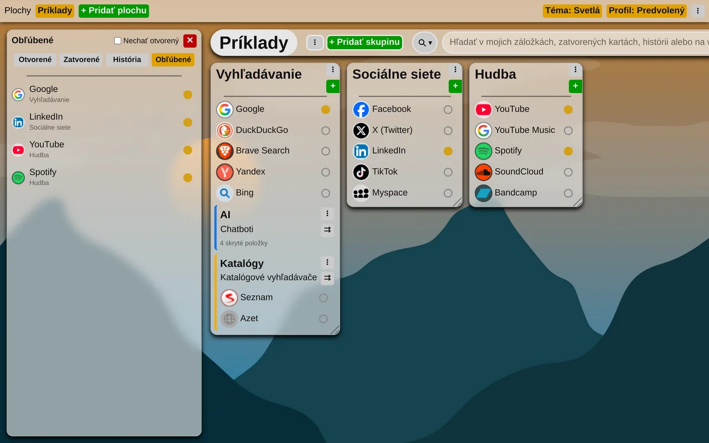
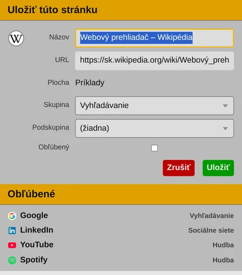

# Označte si obľúbené

Niektoré odkazy otvárate každý deň, iné raz za mesiac. Tie každodenné si označte ako obľúbené a budete ich mať vždy na jedno kliknutie - v bočnom paneli aj v okne ikony na lište.

Obľúbené sú vypnuté, kým si ich nezapnete: otvorte menu (tri bodky vpravo hore) → Nastavenia → „Funkcie“ a zaškrtnite **„Obľúbené“**.

## Označenie odkazu

Odvtedy má každý odkaz na konci krúžok. Kliknite naň a zozlatne - odkaz je obľúbený. Ďalším kliknutím označenie zrušíte.

Odkaz označíte aj z jeho ponuky pravého tlačidla, položkami **„Pridať medzi obľúbené“** a **„Odobrať z obľúbených“**, alebo hneď pri pridávaní, zaškrtnutím **„Obľúbený“** v ukladacom okne.

## Z bočného panela a vyhľadávania

Krúžok majú aj zatvorené karty, história, otvorené karty a návrhy vyhľadávania. Ak otvorená plocha už obsahuje odkaz s touto adresou, krúžok označí ten odkaz. Ak nie, otvorí sa ukladacie okno s už zaškrtnutým „Obľúbený“ - obľúbený musí byť najprv odkazom.

## Karta Obľúbené

Bočný panel má vlastnú kartu **„Obľúbené“**. Zobrazuje obľúbené odkazy plochy, ktorú máte otvorenú, v poradí, v akom ich ukazuje stránka, a pri každom aj skupinu, v ktorej je.

Pretiahnite odkaz na túto kartu a označíte ho. Odkaz zostane tam, kde bol, vo svojej skupine.

Okno ikony na lište zobrazuje tie isté obľúbené pod svojím formulárom, takže ich máte poruke na ktorejkoľvek stránke.

Obľúbené sa synchronizujú s vaším účtom, rovnako ako samotné odkazy.

Viac o bočnom paneli: [Objav históriu](discover-history.md)
