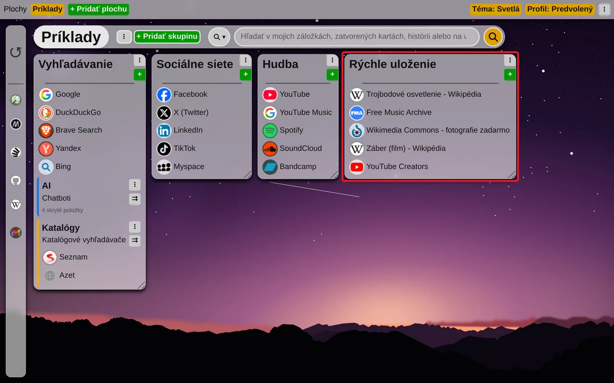
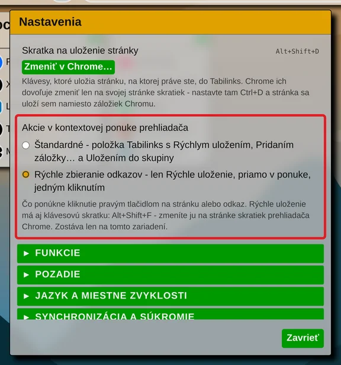

# Rýchle uloženie: stránka jedným kliknutím

Našli ste niečo, čo stojí za to si ponechať, ale nemáte čas rozhodovať, kam to patrí? Rýchle uloženie to uloží hneď a roztriedite si to neskôr.

Kliknite pravým tlačidlom na ktorúkoľvek stránku - alebo na odkaz na nej - otvorte položku **Tabilinks** a zvoľte **Rýchle uloženie**. Stránka sa uloží hneď, bez otázok, do skupiny „Rýchle uloženie“ v ploche, ktorú máte otvorenú. Skupina sa vytvorí pri prvom použití a ikona rozšírenia na lište ukáže fajku na znak, že stránka je uložená.

## Bez myši

**Alt+Shift+F** urobí to isté so stránkou, na ktorej práve ste, celkom bez ponuky. Skratku si môžete zmeniť na stránke prehliadača chrome://extensions/shortcuts.

## Jedno kliknutie namiesto dvoch

V Nastaveniach → „Vzhľad a správanie“ určuje „Akcie v kontextovej ponuke prehliadača“, čo ponúkne ponuka pravého tlačidla:

- **Štandardné** - položka Tabilinks s Rýchlym uložením, Pridaním záložky… a Uložením do skupiny.
- **Rýchle zbieranie odkazov** - len „Tabilinks: Rýchle uloženie“, priamo v ponuke, jedným kliknutím.

## Keď nie je miesto

Plocha pojme 25 skupín. Ak je tá vaša plná a skupinu „Rýchle uloženie“ ešte nemá, nič sa neuloží a okno vám povie prečo. Zmažte niektorú skupinu alebo jednu premenujte na „Rýchle uloženie“, aby sa použila namiesto toho.

## Upratať neskôr

Skupina „Rýchle uloženie“ je obyčajná skupina. Jej odkazy zoradíte voľbou „Zoradiť odkazy“ v ponuke skupiny alebo ich pretiahnete do skupín, kam patria: [Zmeňte veľkosť skupiny a zoraďte jej odkazy](resize-and-sort-groups.md), [Usporiadanie položiek ťahaním myšou](use-drag-and-drop.md)

Zvyšok ponuky pravého tlačidla - uloženie s názvom alebo priamo do vybranej skupiny - nájdete v tipe [Uložiť práve prezeranú stránku](saving-from-webpage.md)

<!--
Still to be pictured by hand (the browser's own menus and toolbar, which a page screenshot cannot capture):
1. flash-save/1 - a web page with the browser's right-click menu open, the Tabilinks submenu showing "Flash save" highlighted.
2. flash-save/2 - the toolbar with the extension's icon showing the tick after a flash save.
5. flash-save/5 - the right-click menu in fast-paced mode, with the single "Tabilinks: Flash save" entry.
Suggested files: 1_1x.webp, 2_1x.webp and 5_1x.webp in images/LANG/tips/flash-save/
-->
