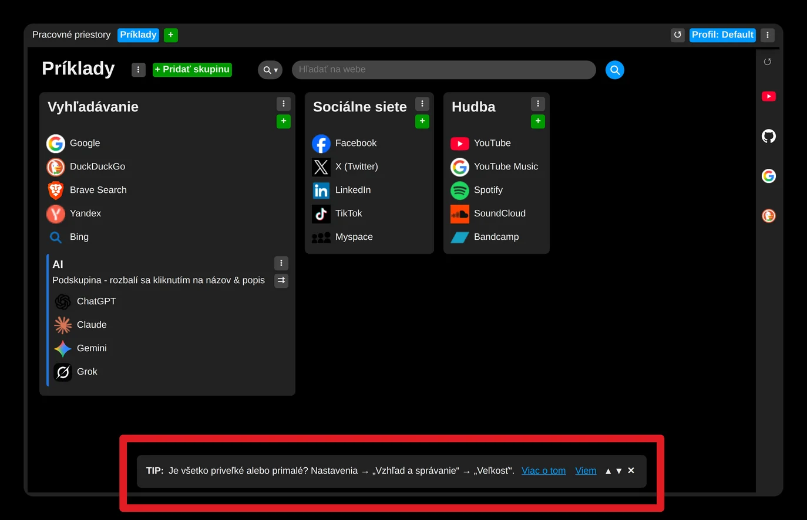
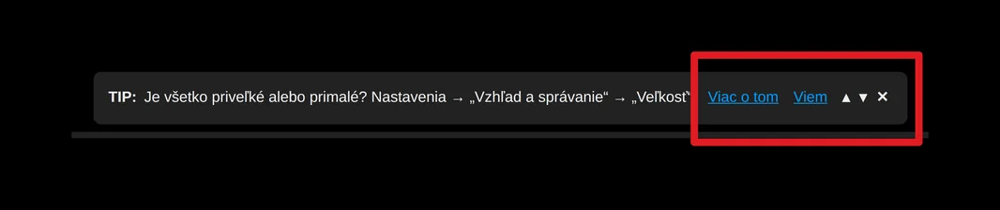
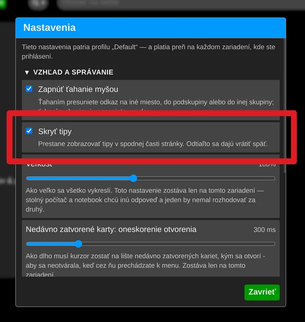

# Skrytie tipov

Ak vás tieto tipy rušia, môžete ich skryť.

- Použite tlačidlo **„X“** na lište s tipmi, alebo otvorte nastavenia rozšírenia a v sekcii „Vzhľad a správanie“ zaškrtnite „Skryť tipy“.
- Prípadne ak Vás tipy zaujímajú, ale niektorý už poznáte a nechcete ho viac zobrazovvať, kliknite na tlačidlo **„Viem“**

