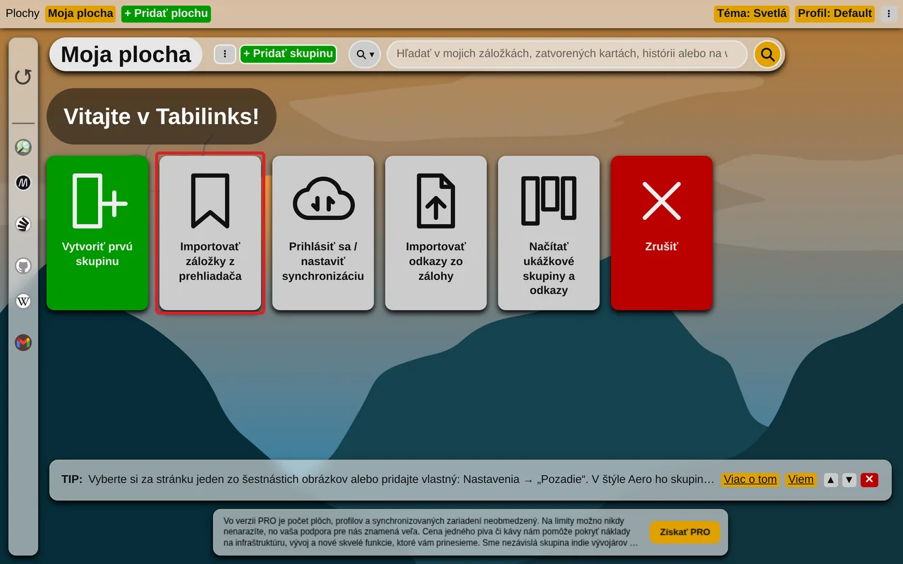
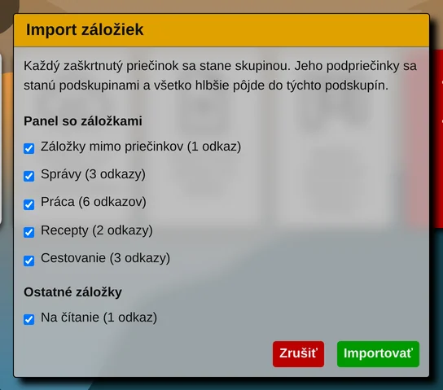
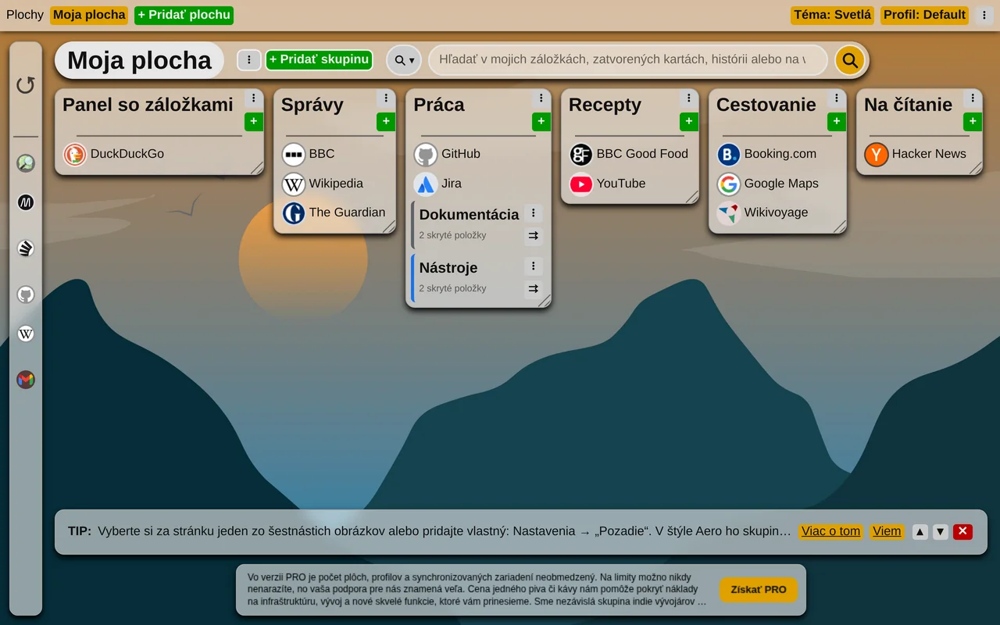
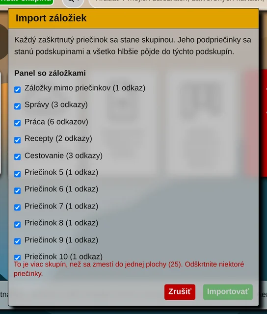

# Importujte záložky z prehliadača

Roky zbierané záložky nemusíte písať znova. Tabilinks dokáže priečinky záložiek vášho prehliadača naraz premeniť na skupiny.

Prázdna plocha ponúka medzi uvítacími dlaždicami aj **„Importovať záložky z prehliadača“**. Kliknite naň. Prehliadač sa raz spýta na povolenie čítať vaše záložky - až v tejto chvíli, nikdy skôr.

## Čo si priniesť

Dialóg ponúkne každý priečinok, ktorý leží priamo v paneli so záložkami, v ostatných záložkách a v mobilných záložkách, pri každom počet odkazov v ňom, a všetky budú zaškrtnuté. Ponúknuté sú aj záložky, ktoré v niektorom z nich ležia voľne, mimo priečinkov - ako skupina pomenovaná podľa neho.

Odškrtnite, čo nechcete, a kliknite na **„Importovať“**:

- z každého zaškrtnutého priečinka bude skupina,
- z jeho podpriečinkov podskupiny,
- všetko hlbšie pôjde do príslušnej podskupiny.

Bookmarklety - záložky, ktorých adresa začína `javascript:` - sa preskočia.

## Limity

Plocha pojme {fairUseGroupsPerWorkspace} skupín, {fairUseSubgroupsPerGroup} podskupín v skupine a {fairUseLinksPerWorkspace} odkazov. Ak by zaškrtnuté priečinky niektorý z týchto limitov prekročili, dialóg povie ktorý a „Importovať“ zostane neaktívne, kým ich neodškrtnete dosť.

## Súkromie

Záložky sa čítajú v prehliadači a nikam sa neposielajú. Po importe sú to obyčajné odkazy a synchronizujú sa s vaším účtom ako všetky ostatné.

Práve ste si nainštalovali Tabilinks? Začnite tu: [Začíname](lets-begin.md)

<!--
Still to be pictured by hand:
2. import-bookmarks/2 - the browser's permission prompt to read bookmarks (the browser's own, a page screenshot cannot capture it).
Suggested file: 2_1x.webp in images/LANG/tips/import-bookmarks/
-->
