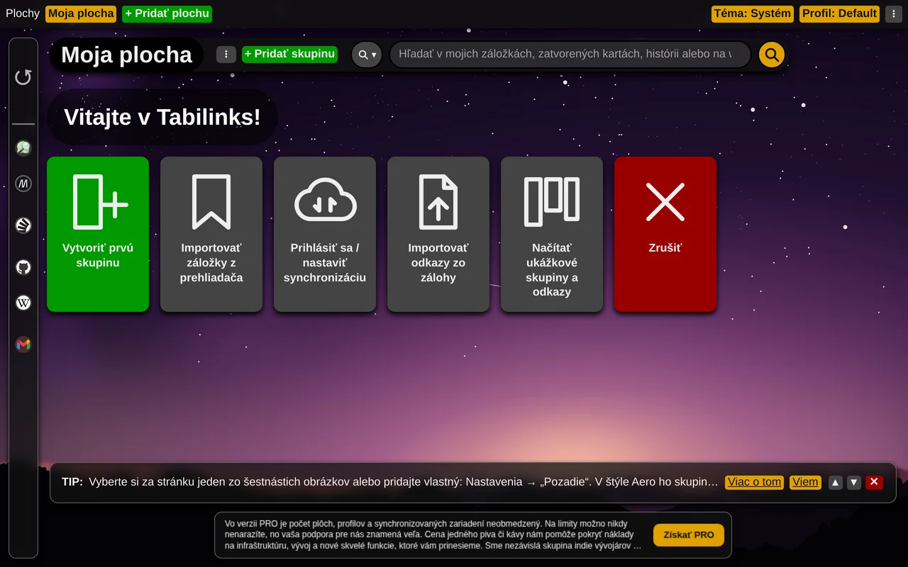
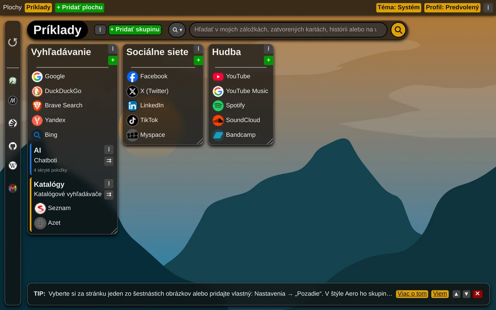
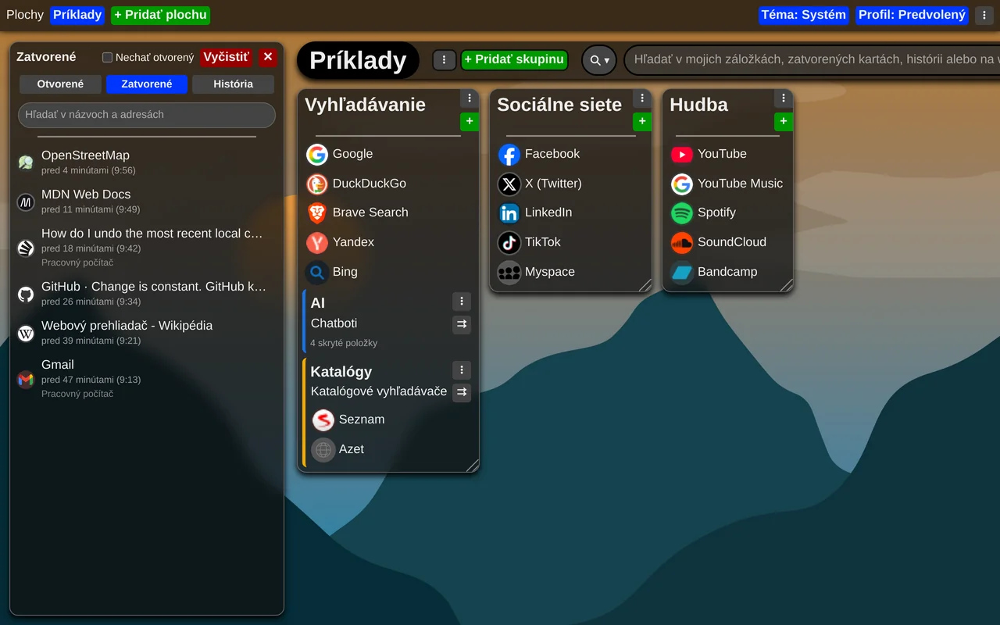
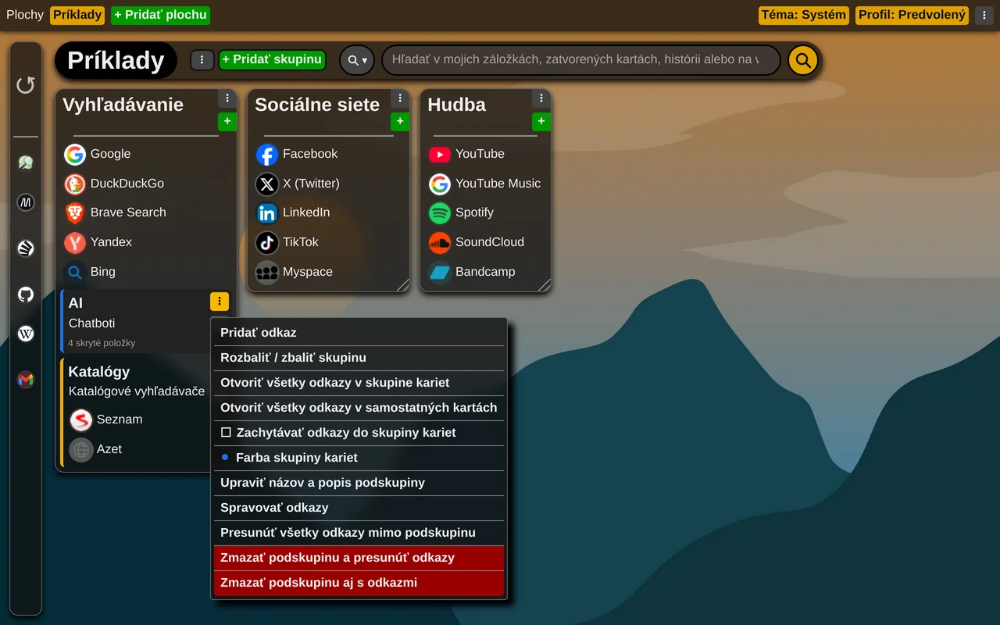
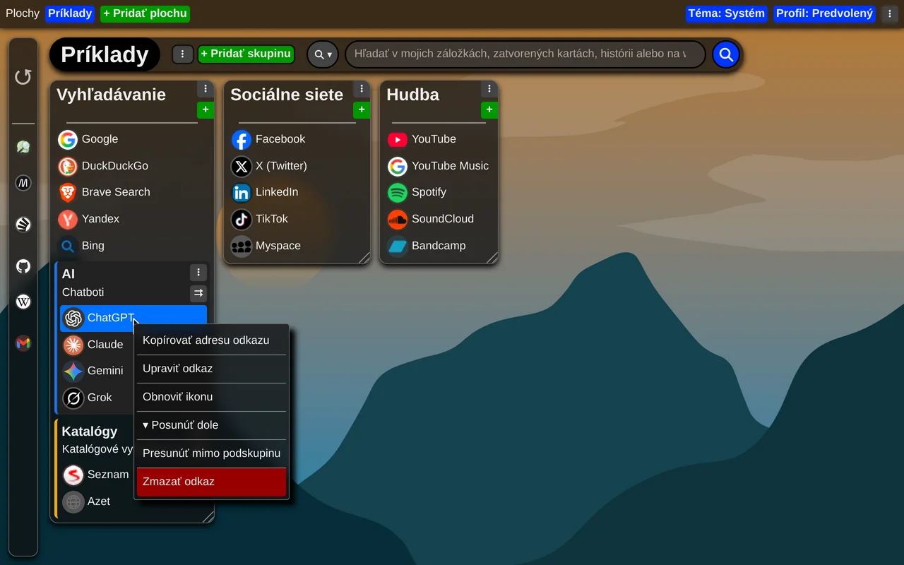

# Začíname

Hneď po inštalácii sa nová karta otvorí rovno vo vašej prvej ploche, „Moja plocha“. Je zatiaľ prázdna, a tak vás privíta nápisom „Vitajte v Tabilinks!“ a niekoľkými spôsobmi, ako ju naplniť:

- **Vytvoriť prvú skupinu** - začnite vlastnou skupinou a pridajte do nej odkazy.
- **Importovať záložky z prehliadača** - z každého priečinka, ktorý zaškrtnete, bude skupina a z jeho podpriečinkov podskupiny. Prehliadač vás o prístup k záložkám požiada až v tejto chvíli.
- **Prihlásiť sa / nastaviť synchronizáciu** - ak už Tabilinks používate inde, prineste si odkazy zo svojho účtu. Zvoľte „Mám meno a heslo“ alebo „Mám kód na synchronizáciu“.
- **Importovať odkazy zo zálohy** - vráťte si odkazy, ktoré ste z Tabilinks predtým exportovali.
- **Načítať ukážkové skupiny a odkazy** - naplňte plochu niekoľkými skupinami známych stránok a pozrite sa, ako všetko vyzerá a funguje. Zostanú len v tomto prehliadači, nikdy sa nesynchronizujú a po prihlásení sa odstránia, ak ste ich nezmenili.

Odvtedy uvidíte svoje odkazy vždy, keď otvoríte novú kartu.

Panel vľavo obsahuje vaše otvorené karty, históriu zavretých kariet a históriu navštívených stránok a od začiatku je otvorený vedľa vašich odkazov.

Ak chcete viac miesta, odškrtnite v hlavičke panela „Nechať otvorený“: panel sa zbalí do pásu ikon pozdĺž ľavého okraja. Keď na ňom chvíľu podržíte myš (predvolene 0,3 sekundy, túto hodnotu si môžete zmeniť v nastaveniach), panel sa znova rozbalí.

Teraz si prezrite menu všade tam, kde nájdete symbol „troch zvislých bodiek“.

Aj odkazy majú vlastné kontextové menu, ktoré otvoríte pravým tlačidlom myši.

## Teraz môžete začať objavovať aj ďalšie funkcie a tipy:

### Manipulácia s položkami:
- [Na usporiadanie a presun položiek je možné použiť Drag and Drop](use-drag-and-drop.md)
- [Uložiť práve prezeranú stránku](saving-from-webpage.md)
- [Rýchle uloženie: stránka jedným kliknutím](flash-save.md)
- [Označte si obľúbené](favorites.md)
- [Importujte záložky z prehliadača](import-bookmarks.md)
- [Objav históriu](discover-history.md)

### Profily
- [Objavte profily a ich využitie](discover-profiles.md)

### Plochy
- [Objavte plochy a ich využitie](discover-workspaces.md)

### Skupiny a podskupiny linkov
- [Zrolovanie podskupiny](roll-the-subgroup.md)
- [Otvoriť všetky linky z podskupiny naraz](open-all-subgroups-link.md)
- [Zachytávať linky z podskupiny do skupiny kariet](subgroup-links-into-tab-group.md)
- [Zmeňte veľkosť skupiny a zoraďte jej odkazy](resize-and-sort-groups.md)

### Nastavenia
- [Je všetko veľké alebo malé ?](set-size.md)
- [Vyberte si farbu zvýraznenia](accent-colour.md)
