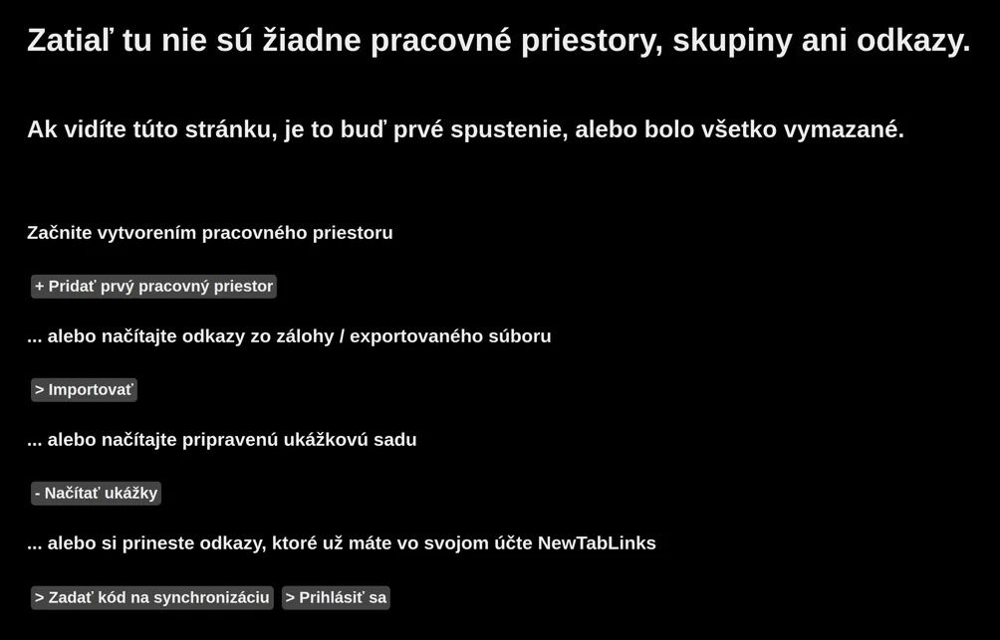
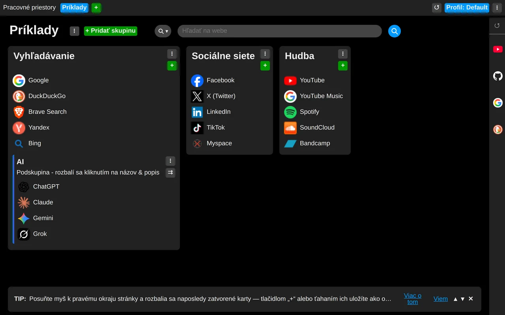
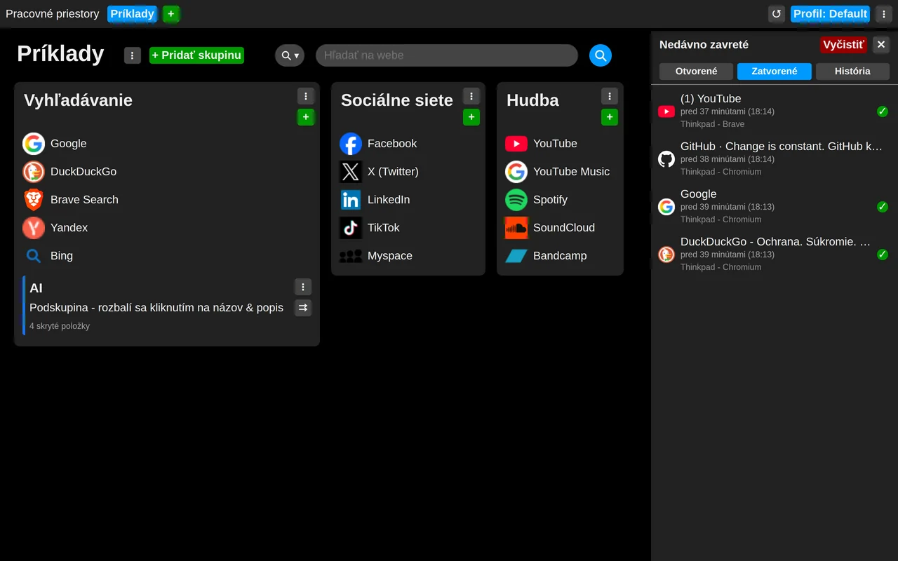
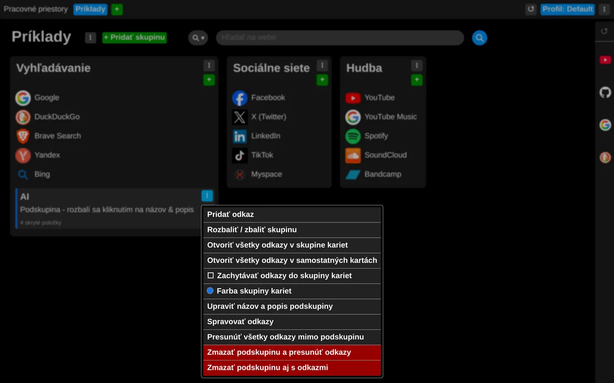
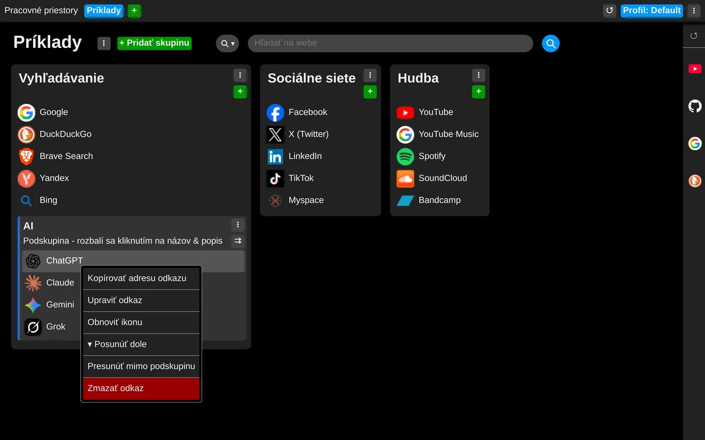

# Začíname

Takto môže vyzerať nová karta, keď ju po úspešnej inštalácii otvoríte prvýkrát:

Predpokladajme, že rozšírenie spúšťate prvýkrát, a tak si môžeme načítať ukážkové odkazy.

Odteraz uvidíte takéto odkazy vždy, keď otvoríte novú kartu.

Panel s ikonami na pravom okraji sú Vaše zavreté karty. Presuňte myš na tento okraj a chvíľu ju
tam podržte (predvolene 0,3 sekundy, túto hodnotu si neskôr môžete zmeniť v nastaveniach) a panel
sa rozbalí.

Teraz si prezrite menu všade tam, kde nájdete symbol „troch zvislých bodiek“.

Aj odkazy majú vlastné kontextové menu, ktoré otvoríte pravým tlačidlom myši.

## Teraz môžete začať objavovať aj ďalšie funkcie a tipy:

### Manipulácia s položkami:
- [Na usporiadanie a presun položiek je možné použiť Drag and Drop](use-drag-and-drop.md)

### Profily
- [Objavte profily a ich využitie](discover-profiles.md)

### Pracovné priestory
- [Objavte pracovné priestory a ich využitie](discover-workspaces.md)

### Skupiny a podskupiny linkov
- [Zrolovanie podskupiny](roll-the-subgroup.md)
- [Otvoriť všetky linky z podskupiny naraz](open-all-subgroups-link.md)
- [Zachytávať linky z podskupiny do skupiny kariet](subgroup-links-into-tab-group.md)

### Nastavenia
- [Je všetko veľké alebo malé ?](set-size.md)

