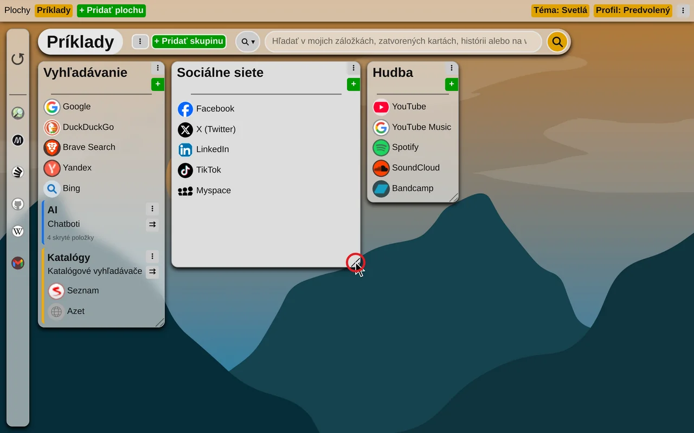
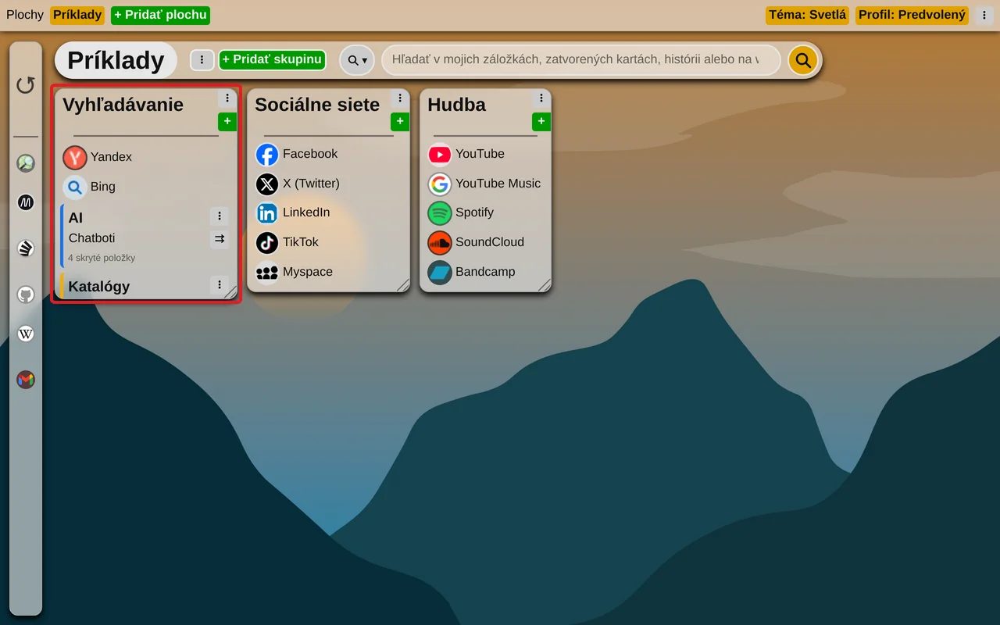
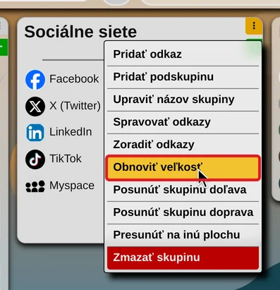
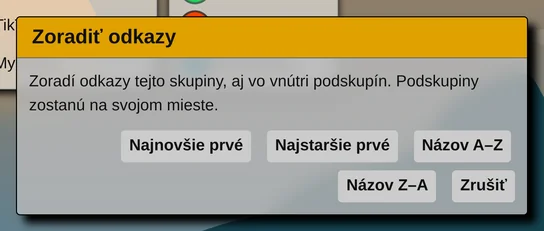

# Zmeňte veľkosť skupiny a zoraďte jej odkazy

Skupina nemusí byť taká široká a vysoká, ako ju urobí stránka. Nastavte jej veľkosť, akú chcete, a jej odkazy zoraďte jedným kliknutím.

## Veľkosť

Potiahnutím pravého dolného rohu skupiny nastavíte jej šírku aj výšku - širšiu, užšiu, vyššiu alebo nižšiu, ľubovoľným smerom. Skupina nižšia, ako sú jej odkazy, sa dá posúvať.

Veľkosť si pamätá len toto zariadenie, takže široká obrazovka aj malý notebook môžu mať každý svoju. K automatickej veľkosti sa vrátite dvojklikom na roh alebo voľbou **„Obnoviť veľkosť“** v ponuke skupiny (tri bodky).

## Zoradenie

V ponuke skupiny zvoľte **„Zoradiť odkazy“** a potom jednu z možností:

- **Najnovšie prvé**
- **Najstaršie prvé**
- **Názov A–Z**
- **Názov Z–A**

Podskupiny si ponechajú svoje miesto a ich vlastné odkazy sa zoradia tiež.

Zoradenie sa urobí raz, nie je to nastavenie: odkazy pridané neskôr pôjdu na koniec a ktorýkoľvek z nich môžete stále presunúť ťahaním. [Usporiadanie položiek ťahaním myšou](use-drag-and-drop.md)

<!--
Still to be pictured:
5. resize-and-sort-groups/5 - the same group before and after sorting by name, a subgroup in the same place in both.
Suggested file: 5_1x.webp in images/LANG/tips/resize-and-sort-groups/
-->
