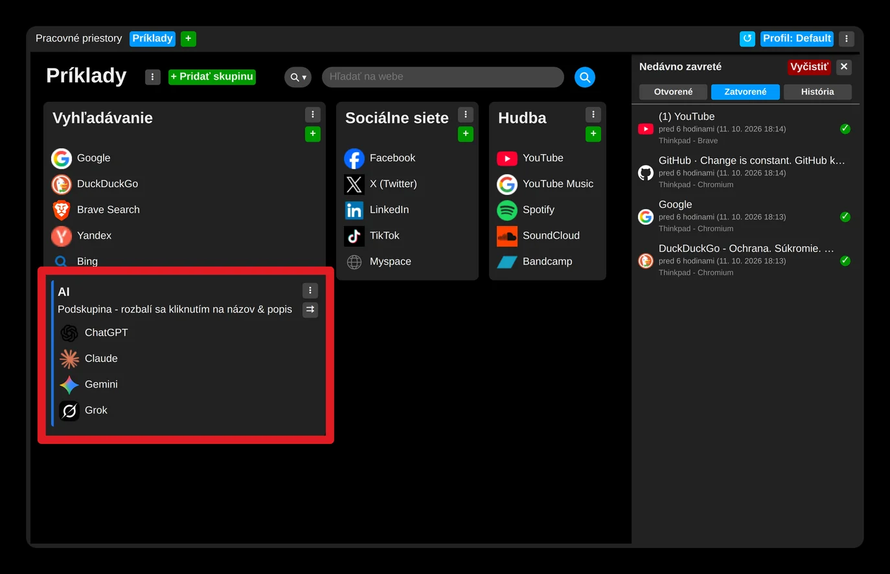
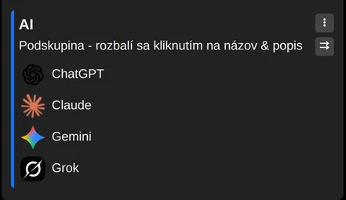
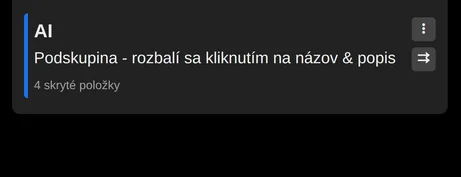

# Zbalenie podskupiny

Odkazy v podskupine môžete skryť tak, že podskupinu zbalíte: kliknite na jej záhlavie, alebo v jej ponuke (ikona troch bodiek) zvoľte „Rozbaliť / zbaliť skupinu“.

Potom sa zobrazí už len počet skrytých položiek a ušetríte tak miesto na výšku.

Nastavenie sa pamätá, takže zbalená alebo rozbalená podskupina takou zostane, a to na všetkých vašich synchronizovaných zariadeniach.

